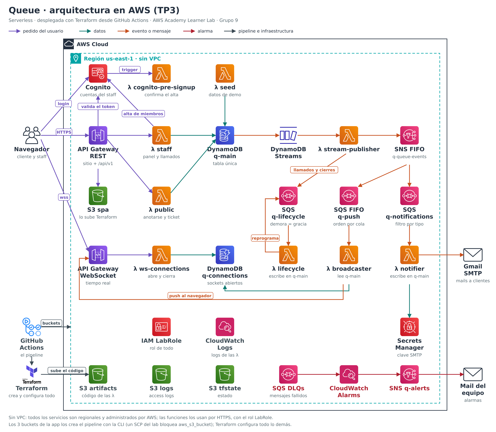

# Queue — Tercera Entrega (IaC con Terraform)

ITBA 82.08 Cloud Computing · Grupo 9.

| Integrante | Legajo |
|---|---|
| Bellavitis Alzate, Nicolás | 64001 |
| Benegas Lynch, José María | 64242 |
| Galán, Agustín | 64098 |
| Koron, Nicolás | 64094 |

Queue es una plataforma de filas virtuales para restaurantes, comercios y cualquier mostrador donde
la gente espera. El cliente escanea un QR, se anota con su nombre y un mail, y sigue su turno desde
el celular. El staff maneja la fila desde un panel.

En esta entrega la arquitectura del TP2 (Spring Boot en EC2 detrás de un balanceador, con RDS) pasó
a ser **serverless**: Lambdas sobre DynamoDB, detrás de API Gateway. Se despliega **entera con
Terraform desde un pipeline de GitHub Actions**, en una cuenta de AWS Academy Learner Lab.

## Dónde está cada punto de la consigna

| Consigna | Sección |
|---|---|
| Archivos Terraform completos | [`terraform/`](terraform/) · [Terraform](#4-terraform) |
| Implementación de correcciones previas | [Correcciones del TP2](#9-correcciones-del-tp2) |
| Mínimo un módulo propio y uno externo | [Módulos](#42-módulos) |
| Variables y outputs | [Variables y outputs](#46-variables-y-outputs) |
| Al menos 4 funciones | [Funciones](#43-funciones) |
| Al menos 3 meta-argumentos | [Meta-argumentos](#44-meta-argumentos) |
| Organización, nomenclatura y DRY | [Archivos](#41-versiones-y-archivos) · [Locals y datasources](#45-locals-y-datasources) |
| Diagrama de arquitectura actualizado | [Arquitectura](#2-arquitectura) |
| Guía paso a paso para ejecución | [Guía paso a paso](#6-guía-paso-a-paso) · [Uso de la aplicación](#7-uso-de-la-aplicación) |
| Pipeline con init, validate, plan, apply y destroy | [Pipeline](#5-pipeline-de-github-actions) |

---

## 1. La aplicación

| Funcionalidad | Cómo se resuelve |
|---|---|
| Ingreso por QR | Cada cola tiene un QR que abre su página; el cliente se anota con su nombre y un mail |
| Seguimiento de la espera | La página del ticket muestra posición, gente adelante y espera estimada, y se actualiza sola por WebSocket |
| Notificaciones | Avisos por mail al anotarse, al acercarse el turno (por posición o por minutos) y cuando le toca |
| Gestión de la fila | Tablero del staff: llamar, atender, ausente, pausar, cerrar; carriles por tamaño de grupo; métricas |
| Abandono y gracia | El cliente puede salir de la fila; si no se presenta, un período de gracia y una política de ausencia deciden qué pasa |
| Idiomas | Castellano e inglés, según el navegador; los mails llegan en el idioma en que se anotó el cliente |

---

## 2. Arquitectura



Cada nodo del diagrama es un recurso que crea este Terraform.

| Servicio | Para qué |
|---|---|
| API Gateway REST | Una sola URL HTTPS para el sitio (leído del bucket privado con `LabRole`) y para la API `/api/v1`. Throttling por ruta |
| API Gateway WebSocket | Actualizaciones en vivo del tablero y del ticket |
| Lambda (9 funciones, Node 22) | `public` y `staff` atienden la API; `ws-connections` maneja los sockets; `stream-publisher`, `broadcaster`, `notifier` y `lifecycle` procesan eventos; `cognito-pre-signup` confirma las altas y `seed` carga la demo |
| DynamoDB | `q-main`, tabla única con todo el negocio y Streams; `q-connections`, los sockets abiertos |
| SNS FIFO y SQS | El bus de eventos: cada cambio de una cola se publica en orden y se reparte a tres colas, cada una con su DLQ |
| Cognito | Cuentas del staff. API Gateway valida el token sin invocar ninguna Lambda |
| Secrets Manager | La contraseña del SMTP de Gmail para los mails (ver [Mails](#8-mails)) |
| S3 | Tres buckets privados: el sitio, el código de las Lambdas y los logs de acceso. Más el del estado de Terraform |
| CloudWatch | Logs de las funciones y alarmas (mensajes en una DLQ, cola atrasada, fallas del stream) que avisan por SNS |

**Flujo de datos**, recorriendo el diagrama:

1. El navegador pide el sitio a **API Gateway REST**, que lo lee del bucket privado **S3 spa** con
   `LabRole`. Junto con el sitio baja `config.json`, que Terraform genera con los ids de Cognito y la
   URL del WebSocket.
2. El staff se registra e inicia sesión directo contra **Cognito**. Un trigger
   (`λ cognito-pre-signup`) confirma la cuenta al instante, y Cognito devuelve un token.
3. El navegador llama a la API en `/api/v1`. Las rutas públicas (anotarse, ver el ticket, salir de
   la fila) van a **`λ public`**. Las del staff llevan el token, que API Gateway valida contra
   Cognito antes de invocar a **`λ staff`**. Cada operación es una transacción en **DynamoDB
   `q-main`** que guarda el cambio y el evento que lo describe, juntos.
4. Para ver los cambios en vivo, el navegador abre una conexión con **API Gateway WebSocket**.
   **`λ ws-connections`** valida el ticket y registra la conexión en **`q-connections`**.
5. **DynamoDB Streams** entrega cada evento a **`λ stream-publisher`**, que lo publica en **SNS
   FIFO**, en orden por cola. Cada llamado va además a **SQS `q-lifecycle`** con una demora igual al
   período de gracia, y cada cierre de cola, sin demora.
6. SNS reparte cada evento a dos colas:
   * **SQS `q-push`** → **`λ broadcaster`** lee el estado actual y lo empuja por el WebSocket al
     tablero del staff y al ticket de cada cliente.
   * **SQS `q-notifications`** → **`λ notifier`** decide qué avisos corresponden, toma la contraseña
     de **Secrets Manager** y manda los mails por el **SMTP de Gmail**.
7. **`λ lifecycle`** aplica la política de ausencia cuando vence la gracia, o libera la cola cerrada,
   escribiendo en `q-main`. Ese cambio vuelve a entrar por el paso 5.
8. Un mensaje que falla todos sus reintentos cae en la **DLQ** de su cola. Una alarma de
   **CloudWatch** avisa por **SNS `q-alerts`** al mail del equipo.

**Sin VPC.** No hay servidores ni bases con IP privada que proteger: todos los servicios son
regionales y administrados por AWS (multi-AZ), y las funciones los usan por HTTPS, autorizadas por
IAM con el rol `LabRole`. Una VPC solo agregaría un NAT Gateway o endpoints para salir hacia esos
mismos servicios, sin aislar nada.

**Restricciones del Learner Lab** que moldearon el diseño: solo existe `LabRole` (no se pueden
crear roles), CloudFront está bloqueado (por eso el sitio lo sirve API Gateway), SES está negado (por
eso los mails salen por Gmail) y un SCP impide crear buckets con `aws_s3_bucket` (ver
[Lo que no crea Terraform](#48-lo-que-no-crea-terraform-y-por-qué)).

---

## 3. Estructura del repositorio

```
terraform/            toda la infraestructura (esta entrega), con la estructura de la plantilla
  organization/       la configuración raíz: la que se inicializa, se planifica y se aplica
    scripts/buckets.sh  crea y borra los buckets de la app (ver 4.8)
    seed/demo.json      los datos de demo
    tests/            terraform test de la raíz
  modules/            los tres módulos propios, cada uno con README y tests
.github/
  workflows/terraform.yml          el pipeline
  actions/terraform-init/          init con el backend remoto, compartido por plan, apply y destroy
  scripts/smoke-realtime.mjs       la prueba de humo del WebSocket
functions/            las Lambdas en TypeScript: src/handlers (una por función), src/domain, tests
frontend/             el sitio (Next.js exportado como archivos estáticos)
docs/diagrams/        el diagrama de arquitectura
```

---

## 4. Terraform

### 4.1 Versiones y archivos

El pipeline usa Terraform `1.16.4`; la configuración admite `>=1.10.0, <2.0.0` porque usa el bloqueo
nativo de S3. [`versions.tf`](terraform/organization/versions.tf) fija los providers AWS `~>6.67.0`,
Archive `~>2.8.0` y Random `~>3.9.0`, y el [lockfile](terraform/organization/.terraform.lock.hcl) versionado
fija las versiones exactas y sus checksums.

El código sigue la estructura de la plantilla del repositorio de la entrega: la configuración raíz en
[`terraform/organization`](terraform/organization/) y los módulos propios en
[`terraform/modules`](terraform/modules/). En la raíz, los archivos están separados por
responsabilidad:

| Archivos | Qué tienen |
|---|---|
| `versions.tf`, `providers.tf`, `backend.tf` | Versiones, región, tags comunes y estado remoto |
| `variables.tf`, `outputs.tf`, `locals.tf`, `data.tf` | Interfaz, valores derivados y lo que ya existe en la cuenta |
| `storage.tf`, `site.tf` | Configuración de los buckets, objetos del sitio y `config.json` |
| `tables.tf` | Las dos tablas de DynamoDB (módulo externo) |
| `functions.tf`, `auth.tf` | Lambdas, sus disparadores SQS y Cognito |
| `api.tf`, `openapi.tf`, `realtime.tf` | API REST (desde un documento OpenAPI) y API WebSocket |
| `events.tf`, `monitoring.tf`, `notifications.tf` | Bus de eventos, alarmas, secreto SMTP e identidades SES opcionales |
| `seed.tf`, `seed/demo.json` | Usuario y datos de demo |

Todos los nombres salen de `var.project` (`q` por defecto) con `format`, y los de los buckets llevan
además la cuenta y la región, así no chocan en ninguna cuenta.

### 4.2 Módulos

| Módulo | Tipo | Se usa en | Qué encapsula |
|---|---|---|---|
| [`lambda-function`](terraform/modules/lambda-function/README.md) | Propio | 9 funciones (`functions.tf`, `auth.tf`) | Empaqueta el bundle (`archive_file`), lo sube versionado al bucket de código, crea la función y su log group con retención. Devuelve nombre, ARN, ARN de invocación y hash del código |
| [`private-bucket`](terraform/modules/private-bucket/README.md) | Propio | 3 buckets (`storage.tf`) | Sobre un bucket existente: bloqueo de acceso público, propiedad de objetos, versionado, ciclo de vida y logs opcionales, y una política que exige TLS |
| [`queue-with-dlq`](terraform/modules/queue-with-dlq/README.md) | Propio | 3 colas (`events.tf`) | Cola estándar o FIFO con su DLQ, redrive, permiso para que SNS publique y alarmas de DLQ y de atraso |
| [`terraform-aws-modules/dynamodb-table/aws`](https://registry.terraform.io/modules/terraform-aws-modules/dynamodb-table/aws/5.5.2) | Externo, versión `5.5.2` fija | 2 tablas (`tables.tf`) | Claves, índice secundario, TTL, Streams y PITR |

Cada módulo propio tiene su README, con las decisiones de diseño, un ejemplo de uso y la referencia
de entradas y salidas generada con terraform-docs, y sus propios tests. Las funciones están
en dos instancias del módulo (`api_functions` y `workers`) para evitar un ciclo: la API REST
depende de las funciones de la API, y algunos workers necesitan la URL de esa API.

El plan muestra un aviso de deprecación de `hash_key`: sale del módulo externo, que en la versión
5.5.2 todavía declara así las claves de las tablas. No cambia lo que se crea.

### 4.3 Funciones

Se usan más de 30 funciones de Terraform. Las principales, con un ejemplo real de cada una:

| Función | Ejemplo | Dónde y para qué |
|---|---|---|
| `jsonencode` | `jsonencode(local.openapi)` | `api.tf`: la API REST entera sale de un documento OpenAPI generado con expresiones `for` desde una tabla de rutas. También políticas y filtros |
| `jsondecode`, `file` | `jsondecode(file("${path.module}/seed/demo.json"))` | `locals.tf`: los datos de demo vienen de un JSON versionado |
| `fileset` | `fileset(var.site_dir, "**")` | `locals.tf`: descubre los archivos del build del sitio sin listarlos a mano |
| `filemd5` | `filemd5("${var.site_dir}/${each.value}")` | `site.tf`: re-sube un archivo solo si cambió |
| `lookup` | `lookup(local.mime_types, lower(regex("[^.]+$", each.value)), "application/octet-stream")` | `site.tf`: el tipo MIME por extensión, con un valor por defecto |
| `sha1` | `sha1(aws_api_gateway_rest_api.this.body)` | `api.tf`: un deployment nuevo de la API cuando cambia su definición |
| `merge` | `merge(local.logged_bucket_names, { logs = format(...) })` | `locals.tf`: compone los nombres de los buckets sin repetir la regla |
| `format` | `format("%s-main", var.project)` | En todos los archivos: nombres a partir del prefijo |
| `toset`, `distinct` | `toset(distinct([for route in values(local.api_routes) : route.function]))` | `api.tf`: un permiso de invocación por función, aunque atienda muchas rutas |
| `try` | `try(aws_secretsmanager_secret.smtp[0].arn, "")` | `locals.tf`: el entorno de la función sirve aunque el secreto opcional no exista |
| `can`, `regex` | `can(regex(local.email_pattern, var.alert_email))` | `variables.tf`: validar mails y formatos |
| `split`, `lower`, `regexall` | `lower(split(" ", route)[0])` | `openapi.tf`: separar método y ruta, y extraer los parámetros de path |
| `fileexists` | `fileexists("${var.site_dir}/404.html")` | `openapi.tf`: usar la página 404 del build si existe |

### 4.4 Meta-argumentos

Se usan los cuatro:

| Meta-argumento | Ejemplo | Para qué |
|---|---|---|
| `for_each` | `for_each = local.queues` en `events.tf` | Una cola por clave del mapa (`push`, `notifications`, `lifecycle`). También las funciones, los buckets, los objetos del sitio, las rutas y las suscripciones |
| `count` | `count = var.demo_enabled ? 1 : 0` en `seed.tf` | Recursos opcionales: los datos de demo, la suscripción de alarmas, el secreto SMTP y las opciones de los módulos |
| `depends_on` | `depends_on = [aws_cloudwatch_log_group.this]` en `modules/lambda-function/main.tf` | Dependencias que ninguna referencia expresa: el log group antes de la función, y el permiso del trigger de Cognito antes de crear el usuario de demo |
| `lifecycle` | `create_before_destroy = true` en `api.tf` y `realtime.tf` | El deployment nuevo de cada API existe antes de borrar el que usa el stage, así la API no queda sin servir |

### 4.5 Locals y datasources

[`locals.tf`](terraform/organization/locals.tf) deriva todo lo que no es una entrada: el sufijo de cuenta y
región, los tags, los nombres de los buckets, los mapas de funciones y de colas, los datos de demo y
los objetos del sitio con su tipo MIME. [`openapi.tf`](terraform/organization/openapi.tf) arma las 35 rutas
de la API desde dos listas: sumar un endpoint es sumar una línea.

| Datasource | Para qué |
|---|---|
| `aws_caller_identity`, `aws_region`, `aws_partition` | Cuenta, región y partición sin escribirlas en el código |
| `aws_iam_role` | El `LabRole` que ya existe en el lab; Terraform no crea roles |
| `aws_iam_policy_document` | Políticas de los buckets y de las colas, como estructura y no como JSON a mano |
| `archive_file` | Empaquetar el bundle de cada función y obtener su hash |

### 4.6 Variables y outputs

Ninguna variable es obligatoria: con los valores por defecto se despliega en cualquier cuenta del
lab. Todas tienen tipo y descripción, y casi todas validación.

| Variable | Default | Qué controla |
|---|---|---|
| `region` | `us-east-1` | Región (el lab habilita `us-east-1` y `us-west-2`) |
| `project` | `q` | Prefijo de todos los nombres |
| `lab_role_name` | `LabRole` | El rol del lab |
| `api_stage_name` | `prod` | Stage de la API, que también es la ruta base del sitio |
| `site_dir`, `functions_dist_dir` | `../../frontend/out`, `../../functions/dist` | Dónde están los builds |
| `log_retention_days`, `access_logs_expiration_days` | `14`, `30` | Retención de logs |
| `site_throttle_*`, `api_throttle_*`, `public_write_*` | — | Límites de pedidos del sitio, de la API y de las rutas anónimas |
| `joins_per_minute` | `60` | Ingresos a una cola por IP y por minuto |
| `session_hours` | `12` | Duración de la sesión del staff |
| `demo_enabled`, `demo_email` | `true`, `demo@queue.example` | Datos y usuario de demo |
| `alert_email` | `null` | Mail que recibe las alarmas |
| `consumer_max_concurrency` | `2` | Ejecuciones simultáneas de cada consumidor |
| `smtp_sender_email` | `null` | Cuenta de Gmail que manda los mails |
| `ses_sender_email`, `ses_verified_recipients` | `null`, `[]` | SES, para una cuenta donde esté permitido |

Outputs: `site_url`, `health_url`, `websocket_url`, `user_pool_id` y `user_pool_client_id` (acceso);
`demo_queue_url`, `demo_staff_email` y `demo_staff_password` (sensitive); `bucket_names`,
`main_table_name`, `connections_table_name`, `function_names`, `stream_mapping_uuid`,
`smtp_secret_id` y `smtp_sender_email` (operación).

### 4.7 Estado remoto y bloqueo

El estado vive en S3, en `tfstate-q-<cuenta>-<región>`, con la clave `queue/terraform.tfstate`
([`backend.tf`](terraform/organization/backend.tf)):

- El bucket lo crea la acción [`terraform-init`](.github/actions/terraform-init/action.yml) la
  primera vez que el pipeline corre en una cuenta, privado y versionado. Tiene que existir antes del
  `terraform init`, así que Terraform no puede crearlo. El nombre no está en el código: el pipeline lo
  pasa con `-backend-config`, y cada cuenta usa el suyo.
- El bloqueo es el **nativo de S3** (`use_lockfile = true`): al empezar, Terraform crea un
  `.tflock` con una escritura condicional, así dos ejecuciones no escriben el estado a la vez. No
  hace falta una tabla de DynamoDB.
- En el pipeline, además, apply y destroy comparten un grupo de concurrencia, y plan, apply y
  destroy esperan el lock hasta 10 minutos (`-lock-timeout=10m`) en vez de fallar.
- El destroy nunca crea el bucket del estado. Si no existe, o si existe sin estado ni buckets
  anotados, no hay nada desplegado en esa cuenta y el job lo informa. Si hay buckets anotados pero no
  estado, el estado se perdió: el job corta con error en lugar de declarar "0 destruidos".
- El estado y el plan guardado (un artefacto del workflow que vence en un día) contienen valores
  sensibles, como la contraseña del usuario de demo: `sensitive` solo los oculta en la salida. Por eso
  el bucket del estado es privado y la contraseña SMTP nunca pasa por Terraform.

### 4.8 Lo que no crea Terraform, y por qué

| Qué | Quién lo hace | Por qué |
|---|---|---|
| Los 3 buckets de la app | [`scripts/buckets.sh`](terraform/organization/scripts/buckets.sh), desde el pipeline, con los nombres que define Terraform | Después de crear un `aws_s3_bucket`, el provider lee su configuración de object lock y un SCP del lab niega esa lectura (`AccessDenied` con deny explícito). Terraform configura todo lo demás del bucket (módulo `private-bucket`) |
| El bucket del estado | La acción `terraform-init` | Tiene que existir antes del `init` |
| El valor de la contraseña SMTP | El job Apply, con la AWS CLI, después del apply | Por Terraform quedaría en texto plano en el plan guardado y en el estado |

**Por qué los buckets se crean con la CLI.** De las tres excepciones, es la única que no es una
decisión de diseño sino una restricción del Learner Lab. Al crear un bucket con `aws_s3_bucket`,
el provider de AWS lee enseguida su configuración de object lock, y en el lab esa lectura está
bloqueada por una política de la organización (SCP):

```
Error: reading S3 Bucket (q-logs-<cuenta>-us-east-1) object lock configuration:
AccessDenied: ... not authorized to perform: s3:GetBucketObjectLockConfiguration ...
with an explicit deny in a service control policy
```

El provider hace esa lectura siempre, en todas las versiones que probamos (4.67, 5.100 y 6.67), y no
hay ningún argumento que la evite. Por eso:

1. El pipeline crea los tres buckets con `aws s3api create-bucket`, usando **los nombres que calcula
   Terraform** (el output `bucket_names` del plan guardado): el nombre no se escribe dos veces.
2. Terraform administra **todo lo demás** de cada bucket con el módulo `private-bucket`: bloqueo del
   acceso público, propiedad de los objetos, versionado, política con TLS obligatorio, registros de
   acceso, ciclo de vida y los objetos que contiene.
3. Al destruir, Terraform borra todo lo suyo y después el pipeline vacía y borra los buckets.

En una cuenta sin esa restricción alcanzaría con volver a declarar `aws_s3_bucket` dentro del módulo.

---

## 5. Pipeline de GitHub Actions

[`.github/workflows/terraform.yml`](.github/workflows/terraform.yml) corre en el pull request:

| Job | Qué hace | Credenciales AWS |
|---|---|---|
| **Validar** | `terraform fmt -check`, `init -backend=false`, `validate`, `terraform test` (raíz y módulos, con providers simulados) y tflint | No |
| **Compilar** | Typecheck, tests y build de las funciones; build del sitio | No |
| **Plan** | `init` con el backend remoto y `terraform plan -out=tfplan`. Deja el plan como artefacto y como comentario en el PR | Sí |
| **Apply** | Espera la aprobación del environment `aws-lab`. Crea los buckets, aplica **el mismo plan guardado**, carga la contraseña SMTP y corre la prueba de humo | Sí |
| **Destroy** | Con la etiqueta `destroy` en el PR (también aprobado): `terraform destroy`, vacía y borra los buckets y, por último, el bucket del estado | Sí |

| Evento | Qué corre |
|---|---|
| Push al PR (abrirlo, actualizarlo, reabrirlo) | Validar y Compilar → Plan → Apply (espera aprobación) |
| Etiqueta `destroy` en el PR | Destroy (espera aprobación) |
| Pull request desde un fork | Validar y Compilar. Plan, Apply y Destroy se saltean, porque el PR no recibe los secrets |
| *Run workflow* manual (`plan`, `apply` o `destroy`) | Lo elegido; solo si el workflow ya está en la rama por defecto |

**La prueba de humo** comprueba después de cada apply que `/api/v1/health` responde (la función lee
y escribe en DynamoDB), que el sitio y `config.json` cargan, que una ruta inexistente da la página
404, y que un cliente puede anotarse en la cola de demo y que un cambio en su ticket le llega por
WebSocket.

**Los workflows de la cátedra.** El repositorio de la entrega trae tres workflows propios de la
cátedra, que corren en paralelo al nuestro en cada pull request y no dependen de él:

| Workflow | Qué hace | Qué esperar |
|---|---|---|
| `terraform-format.yml` | `terraform fmt -check -recursive` con Terraform 1.1.7 | Pasa: el código está formateado (probado con esa versión) |
| `tfsec.yaml` | Análisis de seguridad del Terraform | Reporta los hallazgos que se explican en [Seguridad](#10-seguridad-hallazgos-de-tfsec) |
| `terraform-docs.yml` | Genera la documentación de los módulos de `terraform/modules` y la commitea en la rama del PR | No debería encontrar cambios: el README de cada módulo ya tiene esa sección, generada con la misma versión de terraform-docs que usa el workflow. Si hubiera algo que commitear, necesita que el token del workflow tenga permiso de escritura |

---

## 6. Guía paso a paso

El despliegue está completamente automatizado con **GitHub Actions**: el pipeline compila el código,
crea toda la infraestructura con Terraform y sube la aplicación, sin instalar nada en una máquina
local. Para levantar la arquitectura en una cuenta de AWS Academy Learner Lab hay que seguir estos
pasos.

### Paso 1: Configurar el repositorio (una sola vez)

Antes de la primera ejecución, el repositorio necesita dos elementos que el pipeline usa para
controlar cuándo se crea y cuándo se destruye la infraestructura:

1. **El environment `aws-lab`.** Ingresar a **Settings → Environments → New environment**, crear
   `aws-lab` y, en **Required reviewers**, agregar a quienes pueden aprobar un despliegue. Los jobs
   que crean o destruyen recursos (Apply y Destroy) corren dentro de este environment, así que
   **esperan una aprobación manual** antes de tocar AWS. Si no se agregan revisores, corren sin esperar.
2. **La etiqueta `destroy`.** Ingresar a **Issues → Labels → New label** y crear una etiqueta llamada
   `destroy`. Agregarla a un pull request es lo que dispara la destrucción del stack (paso 4).
3. **Opcional: mails reales y alarmas.** Sin esta configuración la app funciona igual y los mails a
   los clientes se simulan: se escriben en los logs de CloudWatch. Para mandarlos de verdad, ingresar a
   **Settings → Secrets and variables → Actions** y crear:
   * En la pestaña **Variables**:
     * `SMTP_SENDER_EMAIL`: la cuenta de Gmail desde la que salen los mails.
     * `ALERT_EMAIL`: el mail que recibe las alarmas (por ejemplo, un mensaje que cayó en una DLQ).
       AWS manda un mail de confirmación de la suscripción que hay que aceptar.
   * En la pestaña **Secrets**:
     * `GMAIL_APP_PASSWORD`: una [contraseña de aplicación](https://support.google.com/accounts/answer/185833)
       de esa cuenta de Gmail (requiere la verificación en dos pasos). El pipeline la guarda en
       Secrets Manager; nunca queda en el código ni en el estado de Terraform.

### Paso 2: Cargar las credenciales del Learner Lab (en cada sesión)

El pipeline se conecta a AWS con las credenciales temporales del Learner Lab. Como **vencen al
terminar cada sesión del lab** (unas 4 horas), este paso se repite cada vez que se inicia una sesión
nueva:

1. En AWS Academy, abrir el Learner Lab, presionar **Start Lab** y esperar a que el indicador quede
   en verde.
2. Presionar **AWS Details** y, junto a *AWS CLI*, presionar **Show**. Aparecen los tres valores de
   la sesión.
3. En el repositorio, ingresar a **Settings → Secrets and variables → Actions → Secrets** y crear (o
   actualizar, si ya existen) estos secrets:
   * `AWS_ACCESS_KEY_ID`: el identificador de la clave de acceso.
   * `AWS_SECRET_ACCESS_KEY`: la clave de acceso secreta.
   * `AWS_SESSION_TOKEN`: el token de la sesión temporal, obligatorio en AWS Academy.

Los tres tienen que ser de la misma sesión. GitHub los guarda cifrados y los oculta en los logs.

### Paso 3: Desplegar la infraestructura y la aplicación

Con el repositorio configurado y las credenciales cargadas, el despliegue se hace desde un pull
request:

1. **Abrir un pull request** desde una rama de este mismo repositorio, o hacer push a uno que ya
   esté abierto. Para desplegar tiene que ser una rama del repositorio: GitHub no les pasa los
   secrets a los pull requests que vienen de un fork. En un PR desde un fork corren Validar y
   Compilar, y Plan y Apply aparecen como salteados (*skipped*) en lugar de fallar.
2. **El workflow `Terraform` arranca solo.** Se puede seguir desde la pestaña **Actions** o desde los
   checks del pull request. Ejecuta, en orden:
   * **Validar**: revisa el formato del código Terraform (`terraform fmt`), que la configuración sea
     válida (`terraform validate`), corre los tests de Terraform y el linter (tflint). No necesita
     credenciales de AWS.
   * **Compilar**: corre los tests de las Lambdas, las compila y compila el sitio. Tampoco usa AWS.
   * **Plan**: inicializa Terraform con el estado remoto en S3 (`terraform init`) y calcula qué va a
     crear, cambiar o destruir (`terraform plan`). Guarda el plan como artefacto y deja un resumen en
     un comentario del pull request.
3. **Aprobar el despliegue.** Al terminar el plan, el job **Apply** queda en espera. En la ejecución,
   presionar **Review deployments**, marcar `aws-lab` y presionar **Approve and deploy**.
4. **El job Apply crea todo.** Ejecuta, en orden:
   * **Creación de los buckets**: crea los tres buckets de la aplicación (`scripts/buckets.sh`), con
     los nombres que define Terraform. El Learner Lab no deja crearlos desde Terraform (ver
     [4.8](#48-lo-que-no-crea-terraform-y-por-qué)).
   * **Terraform Apply**: aplica exactamente el plan aprobado. Crea las APIs, las Lambdas, las tablas,
     las colas, Cognito y las alarmas, sube el sitio y carga los datos de demo.
   * **Contraseña SMTP**: si se configuró en el paso 1, la guarda en Secrets Manager.
   * **Prueba de humo**: comprueba que la API responda, que el sitio cargue, que un cliente pueda
     anotarse en la cola de demo y que los cambios lleguen por WebSocket. Si algo falla, el job
     termina en rojo.
5. **Listo.** En el resumen de la ejecución (**Summary**), la sección **Desplegado** muestra la URL del
   sitio, la de la cola de demo y el usuario de demo para empezar a usar la app (ver
   [Uso de la aplicación](#7-uso-de-la-aplicación)).

Si el plan falla porque las credenciales vencieron, cargarlas de nuevo (paso 2) y presionar **Re-run
all jobs** en la ejecución.

### Paso 4: Destruir el stack y volver a desplegar

Para eliminar toda la infraestructura y no dejar recursos consumiendo crédito en la cuenta:

1. Si quedó algún apply esperando aprobación, cancelarlo con **Cancel workflow**: un apply pendiente
   bloquea al destroy.
2. En el pull request, agregar la etiqueta **`destroy`** y aprobar el job **Destroy** en `aws-lab`,
   igual que en el paso 3.
3. El job destruye todos los recursos con Terraform, vacía y borra los tres buckets y, por último,
   borra el bucket del estado. El log termina con `Destroy complete!` y una línea `Vaciando y
   borrando:` por cada bucket.
4. Quitar la etiqueta `destroy` del pull request, para que no vuelva a dispararse.

Para volver a desplegar, presionar **Re-run all jobs** en la última ejecución del pull request y
aprobar el apply: el stack se crea de cero.

### Contraseña del usuario de demo

El despliegue crea un usuario de staff de demo, `demo@queue.example`, con una contraseña aleatoria que
queda en el estado de Terraform (marcada como `sensitive`, así que no aparece en los logs). Para
probar la app no hace falta: alcanza con registrar una cuenta nueva desde el sitio. Para leerla, con
Terraform instalado y las credenciales del lab configuradas en la terminal, desde la raíz del
repositorio:

```bash
terraform -chdir=terraform/organization init -input=false \
  -backend-config="bucket=tfstate-q-<cuenta>-us-east-1" \
  -backend-config="region=us-east-1"
terraform -chdir=terraform/organization output -raw demo_staff_password
```

`<cuenta>` es el ID de la cuenta del lab (lo muestra `aws sts get-caller-identity`). Estos comandos
solo leen el estado: no cambian nada en AWS.

### Si algo falla

| Síntoma | Qué hacer |
|---|---|
| El plan falla con `The security token included in the request is invalid` o `expired` | La sesión del lab venció. Cargar de nuevo los tres secrets (paso 2), de la misma sesión, y presionar **Re-run all jobs** |
| El plan falla en *Credenciales del lab* | Falta alguno de los tres secrets de AWS (paso 2) |
| Apply o Destroy quedan en cola sin arrancar | Hay otra ejecución esperando aprobación o corriendo: cancelar la que sobra |
| El apply falló a mitad de camino | Leer el primer error, corregir la causa y presionar **Re-run all jobs**: un plan nuevo parte del estado que quedó |
| La prueba de humo falló | Los recursos ya están creados. Mirar qué comprobación falló y los logs de la función en CloudWatch |
| El sitio carga pero no se puede iniciar sesión | Revisar `config.json` en la URL del sitio: tiene que tener los ids de Cognito |
| El destroy informa que no hay nada desplegado | No existe el bucket del estado, o existe sin estado ni buckets anotados: en esa cuenta nunca se aplicó nada, o ya se destruyó |
| El destroy corta porque hay buckets anotados pero no el estado | El estado se perdió. Revisar las versiones del bucket del estado (está versionado) y restaurar la última antes de reintentar |
| `buckets.sh` corta con "No se pudo comprobar…" o "S3 no pudo borrar…" | Un permiso, una credencial vencida o un objeto protegido. El mensaje dice cuál; la lista de buckets anotados se conserva, así que se puede reintentar |
| Los mails no llegan | Sin `SMTP_SENDER_EMAIL` se simulan: buscar `emailSimulado` en el log de `q-notifier`. Con SMTP, revisar el spam y que `GMAIL_APP_PASSWORD` sea correcta |

---

## 7. Uso de la aplicación

Con la app desplegada, estos son los flujos principales. Conviene probarlos con dos ventanas: una
como staff y otra como cliente.

### Como staff

1. **Crear la cuenta.** En la URL del sitio, presionar **Crear mi primera fila** y completar el nombre
   del negocio, tu nombre, el email y una contraseña de al menos 8 caracteres. La cuenta queda activa
   al instante, sin código de confirmación, y con el negocio creado. También se puede entrar con el
   usuario de demo, que ya tiene un negocio con dos filas (ver
   [Contraseña del usuario de demo](#contraseña-del-usuario-de-demo)).
2. **Crear una fila.** En el panel, presionar **Nueva fila**, ponerle un nombre y presionar **Crear
   fila**.
3. **Imprimir el QR.** Desde la fila, abrir el QR y presionar **Imprimir esta hoja**. Es lo que el
   cliente escanea para anotarse.
4. **Ajustar la fila** (**Ajustes**): el período de gracia y qué pasa con quien no se presenta, cuándo
   avisarle al cliente que se acerca su turno (por grupos por delante o por minutos de espera) y los
   carriles por tamaño de grupo.
5. **Atender la fila** desde el tablero, que se actualiza en vivo:
   * **Llamar al siguiente** llama a quien corresponde, y **Llamar** a alguien en particular.
   * **Listo** lo marca como atendido; **Ausente**, como que no se presentó. Si nadie lo marca, al
     vencer el período de gracia se aplica la política de ausencia.
   * **Pausar** y **Reanudar** dejan de tomar gente nueva sin cerrar la fila; **Cerrar** la cierra y
     libera a todos.
6. **Mirar las métricas** en el panel: atendidos hoy, tiempo de llegada a llamado y ausentes.

### Como cliente

1. **Escanear el QR** de la fila, o abrir la URL de la cola de demo que muestra el resumen del despliegue.
2. Completar el nombre, el email y, si la fila lo pide, cuántas personas son, y presionar **Tomar mi
   lugar en la fila**.
3. La página del ticket muestra la posición, la gente adelante y la espera estimada, y se actualiza
   sola. Llegan mails al anotarse, al acercarse el turno y cuando le toca.
4. **Salir de la fila** libera el lugar y hace avanzar a todos los que están detrás.

---

## 8. Mails

**El Learner Lab niega SES**: `ses:SendEmail`, `ses:CreateEmailIdentity` y `ses:VerifyEmailIdentity`
tienen un deny explícito. Por eso los mails salen por el **SMTP de Gmail** (`smtp.gmail.com:465`,
sobre TLS) desde la cuenta del grupo, y llegan a cualquier dirección.

La contraseña de aplicación de esa cuenta es el único secreto del sistema, y se maneja como tal:
está en el secret de GitHub y en Secrets Manager (cifrada), nunca en un archivo, en el repositorio,
en el plan ni en el estado de Terraform. Terraform crea el secreto vacío y el job Apply le carga el
valor con la CLI. El `notifier` lo lee al mandar.

Sin `SMTP_SENDER_EMAIL`, el `notifier` escribe cada mail en su log de CloudWatch (`emailSimulado`),
lo que la consigna permite. El código de SES sigue disponible para una cuenta donde esté permitido.

---

## 9. Correcciones del TP2

| Corrección | Cómo quedó |
|---|---|
| **Separar el bucket privado en tres** | `spa` (el sitio), `artifacts` (el código de las Lambdas, versionado) y `logs` (registros de acceso de los otros dos). Los tres privados, con TLS obligatorio, por el módulo `private-bucket` |
| **«Falta encriptar»: contraseñas en texto plano en el `.env`** | Ninguna contraseña vive en un archivo de configuración: Cognito reemplazó el JWT propio, DynamoDB no tiene contraseña y los servicios se usan con IAM. El único secreto (la contraseña de Gmail) está cifrado en Secrets Manager y fuera del estado de Terraform |
| **Justificar RDS con el nuevo cómputo** | Elegimos DynamoDB por los patrones de acceso por cola, la capacidad bajo demanda y la integración con Streams. Evita administrar conexiones SQL y simplifica la infraestructura de esta aplicación |
| **Justificar el pub/sub con el nuevo cómputo** | El `LISTEN/NOTIFY` de PostgreSQL coordinaba varias instancias de EC2. Sin servidores, cada cambio se publica desde el stream de DynamoDB en SNS FIFO (en orden por cola) y se reparte a colas SQS, cada una con su consumidor, su DLQ y su alarma |
| **Desplegar con IaC** | Todo con Terraform desde el pipeline, con estado remoto, plan guardado y aprobación |

---

## 10. Seguridad: hallazgos de tfsec

El repositorio de la entrega corre [tfsec](https://github.com/aquasecurity/tfsec) en cada pull
request. Lo que marca sobre esta configuración, y qué se decidió con cada cosa. Los hallazgos de
severidad alta que se dejan a propósito están marcados en el código con un comentario
`#tfsec:ignore:<regla>` y su motivo, al lado del recurso:

| Hallazgo | Decisión |
|---|---|
| Colas SQS sin cifrar (HIGH) | **Resuelto.** Las tres colas, sus DLQs y la de fallas del stream declaran `sqs_managed_sse_enabled = true`: cifrado en reposo con la clave que administra SQS, sin KMS ni costo |
| Tablas DynamoDB sin cifrado (HIGH) | DynamoDB cifra **siempre** en reposo, con una clave de AWS. tfsec pide además una clave KMS, que agrega costo por pedido y no cambia qué datos quedan protegidos |
| Tópicos SNS sin cifrar (HIGH) | Un mensaje vive en SNS solo hasta entregarse a las colas SQS, que sí están cifradas. En `q-alerts`, además, las alarmas de CloudWatch no pueden publicar en un tópico cifrado con la clave administrada de AWS: harían falta una clave KMS propia y su política |
| API Gateway sin access logs (MEDIUM) | Cada función deja sus logs en CloudWatch, y API Gateway publica sus métricas. Los access logs necesitan un rol de CloudWatch para toda la cuenta, que no se probó en el Learner Lab |
| `q-connections` sin PITR (MEDIUM) | A propósito: guarda sockets abiertos que vencen en dos horas, no hay nada que recuperar. `q-main`, la que tiene los datos del negocio, sí tiene PITR |
| Sin caché en la API (LOW) | Las respuestas cambian con cada movimiento de la fila, y la caché de API Gateway se cobra por hora |
| Sin trazas de X-Ray (LOW) | X-Ray no fue parte de la cursada; los logs de cada función alcanzan para seguir un pedido |
| Log groups sin clave propia (LOW) | CloudWatch Logs ya cifra en reposo; una clave KMS propia solo cambiaría quién la administra |

---

## 11. Tests y verificación local

```bash
cd functions && npm ci && npm test        # unitarios e integración (necesita Docker: DynamoDB Local)
```

```bash
cd terraform
terraform fmt -check -recursive           # la raíz y los módulos
tflint --init && tflint --recursive
cd organization
terraform init -backend=false && terraform validate
terraform test                            # en modo plan, con providers simulados: no usa AWS
for module in ../modules/*/; do (cd "$module" && terraform init -backend=false && terraform test); done
```

Los tests de Terraform comprueban que la configuración entera planifica con los valores por defecto,
los contratos de cada módulo y que las validaciones rechazan entradas inválidas. Cada módulo tiene los
suyos en `terraform/modules/*/tests`. El pipeline corre todo esto en cada push.
