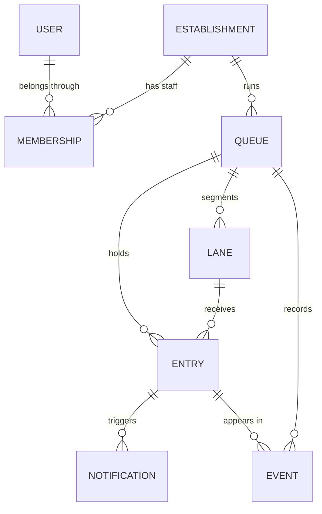
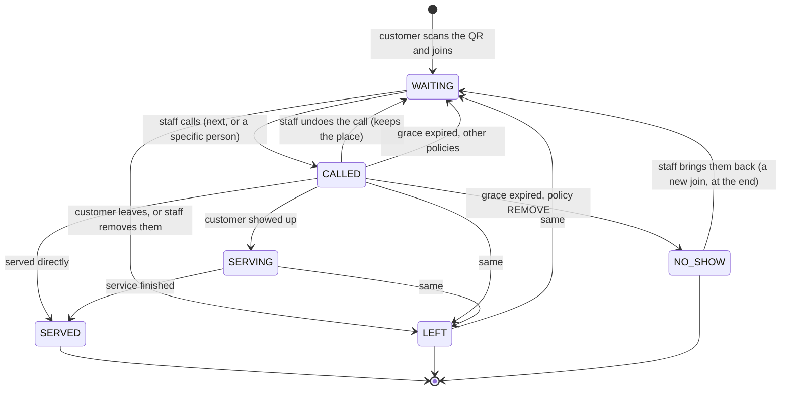

# Q (Queue) - domain model

Everything below is the MVP scope of *Funcionalidades 1-5* of the proposal, and nothing more. The
rules live in [`functions/src/domain/`](../functions/src/domain/), which knows nothing about DynamoDB;
[`functions/src/persistence/`](../functions/src/persistence/) turns what they change into writes.

## Entities



| Entity | Purpose |
|---|---|
| user | A staff-side login, in Cognito. Its `sub` is the user id everywhere else. Customers never get one. |
| establishment | A business location. Owns its time zone, which anchors "today" in metrics. |
| membership | Links a user to an establishment as `OWNER` or `STAFF`. |
| queue | One line = one service = one QR code. Holds all tunable behaviour. |
| lane | A party-size band inside a queue. Every queue has at least one. |
| entry | One customer's place, addressed by an opaque `ticketToken`. |
| event | Append-only timeline of everything that happened. Also what drives everything asynchronous. |
| notification | One alert aimed at one customer, with its delivery outcome. |

Everything except the users lives in one DynamoDB table, `q-main`, with generic `PK`/`SK` keys. The
keys are all built in [`keys.ts`](../functions/src/persistence/keys.ts):

| Item | PK | SK |
|---|---|---|
| queue | `QUEUE#<queueId>` | `META` (carries the queue's `version`) |
| lane | `QUEUE#<queueId>` | `LANE#<laneId>` |
| entry, waiting | `QUEUE#<queueId>` | `W#<orderKey>` |
| entry, called or being served | `QUEUE#<queueId>` | `A#<entryId>` |
| entry, finished | `QUEUE#<queueId>` | `F#<finishedAt>#<entryId>` |
| event | `QUEUE#<queueId>#EV` | `<version>#<index>#<eventId>` (kept 30 days) |
| ticket → entry | `TICKET#<token>` | `TICKET` |
| entry → its current SK | `ENTRY#<entryId>` | `REF` |
| notification | `ENTRY#<entryId>` | `NOTIF#<type>#<cycle>` |
| establishment | `EST#<id>` | `META` |
| queue of an establishment | `EST#<id>` | `QUEUE#<queueId>` |
| member of an establishment | `EST#<id>` | `MEMBER#<sub>` |
| membership of a user | `USER#<sub>` | `EST#<id>` |

An entry's SK encodes its state, so one query by prefix returns each group already in order: `W#` is
the line, `A#` the people at the counter, and `F#` the finished ones by end time, which is what the
metrics read for a date range. Open WebSocket connections live in a second table, `q-connections`.

### Why a customer has no account

The proposal asks for "datos minimos" and no app install. A customer supplies a name plus **at
least one contact channel**, and gets back an unguessable `ticketToken`. The token is the whole
credential: it is in the link that is sent to their email, so closing the browser or switching
device costs them nothing.

## Ordering: how a position is decided

Positions are **never stored**. Each waiting entry carries an `orderKey`, and the position is simply
its index in the waiting list sorted by that key. This means a position can never disagree with the
real line.

The keys are strings ([`ordering.ts`](../functions/src/domain/ordering.ts)). Joining at the end takes
the queue's next sequence number in fixed-width base 62; putting someone between two neighbours takes
the lexicographic midpoint of their keys. There is always another string between two strings, so the
line never has to be renumbered, which in DynamoDB would mean rewriting every waiting item. Keys
compare by character code, exactly as DynamoDB orders a string sort key, so the order of the query is
the order of the line.

## Entry state machine



`WAITING`, `CALLED` and `SERVING` are **active**: they hold a place and count against `maxSize`.
`SERVED`, `LEFT` and `NO_SHOW` are terminal and stamp `finishedAt`, which is what the metrics window
filters on.

Bringing back somebody who had finished goes through the same checks as joining, in the same order:
their own lane if it still accepts their party size (otherwise the lane that accepts it today), that
lane's capacity, then the queue's. Their lane may have been switched off or retired while they were
out.

## Lanes and archiving

A queue keeps a single QR code but can be split into lanes, each with a party-size band, a priority,
a capacity (`PERSONS` adds up people; `GROUPS` counts entries), a time factor and an active flag.
Active bands may be disjoint or nested, but never partially overlap; a joining group goes to the
innermost active band that contains its size, the most specific rule for it. Call priority plays no
part in that choice. A queue always keeps at least one active lane, and a lane with people in it
cannot be switched off or retired. A new queue starts with a single lane, `1+`.

Deleting a lane retires it: it stops taking people, but the entries it served still point to it.

`DELETE /queues/{id}` archives the queue: it is closed and hidden from listings, and every entry,
event and notification is kept, so the metrics computed from them stay honest.

## Queue status

| Status | New customers | Staff can call/serve |
|---|---|---|
| `OPEN` | yes | yes |
| `PAUSED` | no | yes |
| `CLOSED` | no | no |

Closing a queue **releases everyone still in it** as `LEFT` and sends them a `QUEUE_CLOSED`
notification. The alternative - leaving customers holding a place in a queue that stopped
operating - is worse than telling them.

Closing itself is immediate: from that moment nobody joins and nobody is called. The release happens
afterwards, in `λ lifecycle`, in batches of 24 entries, because each released entry writes four items
and a DynamoDB transaction takes at most 100.

## Grace period and no-show policies

When a customer is called, `graceExpiresAt` is set to `now + gracePeriodSeconds`.
`gracePeriodSeconds = 0` means the clock never decides; only staff do.

When the deadline passes, the queue's `noShowPolicy` applies:

| Policy | Result |
|---|---|
| `KEEP_POSITION` | Back to `WAITING` in the same place. |
| `MOVE_BACK` | Back to `WAITING`, `moveBackPositions` places further down. |
| `MOVE_TO_END` | Back to `WAITING` at the end of the line. |
| `REMOVE` | `NO_SHOW`; the place is gone. |

Expiry is evaluated in several places, on purpose:

* **on a timer**: when someone is called, `λ stream-publisher` sends a message to the `q-lifecycle`
  SQS queue, delayed until the deadline, and `λ lifecycle` applies it - so a queue nobody is watching
  does not stall on a customer who never showed up;
* **on every read** of a queue or a ticket, so nobody is shown a call the clock already invalidated;
* **at the start of every operation** on the queue, so nothing is decided on such a call either.

They all go through `expireDue` on the current state and write conditioned on the queue's version:
the first one wins, and the others find nothing left to expire. If staff served the person a second
before, there is nothing to expire at all.

## Estimated waiting time

```
averageServiceTime = mean of the last 10 completed services (Queue.recentServiceSeconds)
                     falling back to the queue's defaultServiceMinutes until there is any history

Wait is simulated from shared stations: called/serving groups reserve a station for their
lane-adjusted average duration (times the lane's timeFactor), then waiting groups are scheduled
through the configured call strategy.
```

`peopleBeingAttended` (entries in `CALLED` or `SERVING`) is counted because those customers occupy
the service stations before anyone waiting gets a turn. There is no double counting: they are no
longer in the waiting list.

The simulation uses the same selector as the real "call next" ([`selector.ts`](../functions/src/domain/selector.ts)),
so the wait a customer is shown comes from the same rules that will call them.

Responses expose `usingDefaultServiceTime`, so the UI can be honest about an estimate that is a
configured guess rather than a measurement.

## Notifications

| Type | Fires when |
|---|---|
| `TICKET_CREATED` | On join. **Carries the personal ticket link.** |
| `APPROACHING_POSITION` | `groupsScheduledAhead <= notifyAtPosition` under the configured call strategy |
| `APPROACHING_TIME` | `estimatedWaitMinutes <= notifyAtMinutes` |
| `YOUR_TURN` | The customer is called. |
| `NO_SHOW` | The grace period expired; explains what the policy did. |
| `QUEUE_CLOSED` | The queue was closed while they waited. |

Notifications are decided by `λ notifier`, after the change has been committed: every event that can
move someone's place reaches it through SNS and the `q-notifications` SQS queue. It does not decide
from the event but from the current state of the queue, because one movement can make dozens of
people cross a threshold at once. Two evaluations of the same state select the same notices;
conditional claims suppress repeat sends after a completed notification.

Each notification uses the key `NOTIF#<type>#<cycle>`. A conditional update claims a notice if it
is new, FAILED, or PENDING with an expired 120-second lease, subject to a five-attempt budget. SENT
notices are skipped. When a customer returns to WAITING after a no-show, its cycle advances and
notices become eligible again. This is application-level deduplication, independent of SNS's
five-minute window. It does not make SMTP sending and recording SENT atomic: a crash between them
can cause a duplicate email. An active or exhausted claim is skipped without itself failing the
SQS record. See [failure handling](architecture.md#6-concurrency-and-correctness).

Notifications go by email, and only to the email: a customer who left just a phone number has no
channel (there is no SMS). The Learner Lab denies SES, so they go through Gmail's SMTP server from
the group's account ([`smtp.ts`](../functions/src/notifications/smtp.ts)); without that account
configured, every email is written to the function's log instead and recorded as channel `LOG`. A
failed send is recorded on the item and reported for retry, up to the claim budget of 5 attempts;
it never undoes a queue movement. Simulated sends are recorded as SENT with channel LOG, which
means the simulated path completed, not that an email was delivered.

## Metrics

Ranges are anchored to the **establishment's local calendar day**, not UTC, so "today" means what
the staff behind the counter think it means.

| Field | Definition |
|---|---|
| `waitingNow`, `inServiceNow` | Live counts. |
| `servedCount`, `noShowCount`, `leftCount` | Entries that reached that terminal state inside the range. |
| `averageWaitMinutes` | Mean of `calledAt - joinedAt` over served entries. |
| `averageServiceMinutes` | Mean of `finishedAt - servingStartedAt` over served entries. |
| `abandonmentRate` | `leftCount / finishedCount` |
| `noShowRate` | `noShowCount / finishedCount` |

## Concurrency

DynamoDB has no locks. Every change to a queue reads its items, including `META.version`, decides in
memory, and writes everything it changed in **one transaction conditioned on that version**
([`queue-store.ts`](../functions/src/persistence/queue-store.ts)). If another writer got there first,
the transaction is cancelled, and the operation re-reads and decides again, up to 8 times with
backoff. DynamoDB transactions are serialisable among themselves, so:

* two staff members pressing "call next" at the same moment produce exactly one call each, on
  different people;
* simultaneous joins cannot be handed the same place;
* the grace timer never races the panel.

If the retries run out, the API answers `409 CONCURRENT_MODIFICATION`: nothing was written, and
sending the request again is safe.

The events an operation produces are items in that same transaction, so an event exists if and only
if the change it describes was committed. Everything asynchronous (pushes, notifications, the grace
timer, releasing a closed queue) starts from those events.
