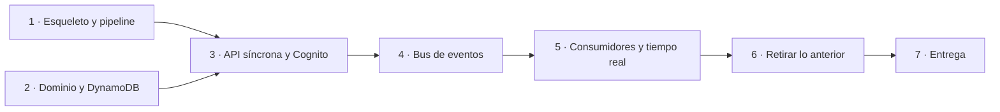

# Roadmap: migración a serverless + Terraform + GitHub Actions

Plan para llegar a la entrega del TP3 partiendo del sistema actual (Spring Boot + PostgreSQL,
desplegado a mano) y terminando en la arquitectura de
[arquitectura-serverless.md](arquitectura-serverless.md), desplegada con Terraform desde un pipeline
de GitHub Actions.

**Lectura vigente:** [README Terraform](../../infra/terraform/README.md), [guía de despliegue](../deployment.md)
y [arquitectura implementada](../architecture.md). Las fases anteriores conservan el plan original;
la lista de entrega y la matriz de requisitos de abajo describen el estado revisado el 2026-10-20.

---

## Cómo se evalúa

| Criterio de la rúbrica | Peso | Qué significa para nosotros | Dónde |
|---|---|---|---|
| Correcta implementación y uso de módulos | **20 %** | Módulos propios con una responsabilidad clara, reutilizados de verdad, con la estructura que pide la clase 10 | [Módulos](#módulos) |
| Usan un módulo externo | **10 %** | Uno del Registry, con la versión fijada y usado con sentido | [Módulos](#módulos) |
| Usan correctamente 4 funciones y 3 meta-argumentos | 5 % | Cada uno con un motivo que se pueda explicar, no puesto para cumplir | [Requisitos](#requisitos-de-terraform-y-dónde-se-cumplen) |
| Calidad de código Terraform | **10 %** | Formato, validación, linter, variables tipadas y documentadas, nada escrito a mano | [Calidad](#calidad-de-código) |
| Correcto uso de locals y datasources | 5 % | Locals para lo que se deriva; datasources para lo que no administramos | [Requisitos](#requisitos-de-terraform-y-dónde-se-cumplen) |
| Claridad del README | **10 %** | Módulos, funciones, meta-argumentos y una guía que la cátedra pueda seguir sin preguntarnos | Fase 7 |
| Despliegue correcto de la arquitectura | **20 %** | El pipeline crea **todo**, en una cuenta que no es la nuestra, sin pasos a mano | Fases 1, 3 a 5 |
| El TP funciona correctamente | **20 %** | La app desplegada se puede usar de punta a punta | Fases 3 a 5 |

Tres conclusiones que ordenan todo el plan:

1. **El 40 % es que se despliegue y funcione.** La reescritura del backend no suma puntos por sí
   misma: es un costo que tiene que terminar en algo que funciona. Como no hay un plan B, la defensa
   es el orden: un esqueleto desplegado desde la Fase 1, cada fase desplegada por el pipeline antes de
   darla por terminada, y una [lista de recortes](#si-el-tiempo-no-alcanza) decidida de antemano.
2. **El 30 % son módulos.** Se diseñan antes de escribir los recursos, no se extraen al final.
3. **Lo que la consigna exige sin estar en la rúbrica** (pipeline en el PR, correcciones del TP2,
   diagrama) es condición para aprobar y probablemente pese dentro de "despliegue correcto". No se
   recorta.

### Lo que además pide la consigna

| Pedido | Dónde |
|---|---|
| "Implementar la arquitectura diseñada" | Cambiamos el diseño del TP2: el README explica la evolución y el diagrama la refleja (Fase 7) |
| Correcciones del TP2 implementadas | [Ajustes al diseño](#ajustes-al-diseño) |
| Variables y outputs para parametrizar | Fase 1 en adelante |
| Organización lógica, nomenclatura consistente, DRY | [Calidad](#calidad-de-código) |
| Pipeline con init, validate, plan, apply y destroy, **que se ejecute correctamente en el pull request** | Fase 1. El ciclo completo tiene que poder correrse desde el PR, que probablemente no se mergee antes de la corrección |
| El pipeline documentado en el README | Fase 7 |
| Diagrama actualizado y alineado con el código | Fase 7 |
| PR al repositorio de la cátedra y hash del commit en el campus | Fase 7 |
| Se permiten datos simulados | Datos de demo en la Fase 3 |

**La cátedra tiene que poder correrlo**, y la consigna lo marca como crítico. Eso descarta valores
fijos de nuestra cuenta, pasos manuales fuera del README y cualquier recurso que no se pueda destruir.

---

## Decisiones tomadas

| Decisión | Elegido | Consecuencia |
|---|---|---|
| Autenticación del staff | **Cognito** | La API REST valida el token con un authorizer de Cognito, sin ejecutar ninguna Lambda. Desaparecen el login propio, BCrypt, la Lambda authorizer y el secreto del JWT |
| Canales de aviso | **Gmail SMTP en el lab; SES opcional donde esté permitido** | Sin Web Push ni SMS. El app password vive en Secrets Manager; sin configuración se simula el email |
| Origen del PR | **Una rama en el repositorio de la cátedra** | Ahí se cargan los secrets, y el workflow del PR los recibe. Desde un fork no los recibiría |
| Punto de control | **No hay** | Se va con serverless hasta el final. El riesgo se maneja con el orden de las fases y la lista de recortes |
| Lenguaje de las funciones | **TypeScript sobre Node 22**, todo en `functions/` | Arranques en frío de ~200 ms sin SnapStart, un solo lenguaje para las Lambdas y el frontend, y bundles de pocos KB con esbuild. El dominio se porta desde Java en lugar de extraerse a un módulo Maven; `backend/` queda solo como referencia hasta la Fase 6 |

Cognito elimina el secreto JWT propio. Los servicios AWS se autentican con IAM; Gmail SMTP agrega
un app password guardado en GitHub Secrets y Secrets Manager. La contraseña del usuario de demo
también es sensible y queda en el estado de Terraform.

---

## Ajustes al diseño

`arquitectura-serverless.md` es la base, con estos cambios:

| # | Ajuste | Motivo |
|---|---|---|
| 1 | Despliegue con **Terraform y GitHub Actions**, no con SAM ni desde la máquina local | Lo exige la consigna |
| 2 | **Secreto SMTP fuera del repositorio, plan y estado:** Cognito reemplaza el JWT propio; Gmail usa Secrets Manager. El password de demo sí queda en estado | Corrección del TP2: "falta encriptar", por las contraseñas de `app.env` subidas en texto plano |
| 3 | **Tres buckets privados:** `spa`, `artefactos` (zips de las Lambdas) y `logs` (access logs de los otros dos) | Corrección del TP2: "separaría el bucket privado en 3" |
| 4 | **Justificar en el README por qué no hay VPC** | El corrector elogió la parte de red; su ausencia tiene que leerse como una decisión |
| 5 | **Las métricas históricas quedan fuera de esta entrega** (Firehose, el data lake, Glue y Athena). Se mencionan en el README como trabajo futuro. Tampoco X-Ray, que no se vio en clase | Recorta alcance. Las métricas del día ya salen de los ítems `F#` |
| 6 | CloudFront figura como **bloqueado por el lab**, no como decisión del equipo | Es lo que pasó en el TP2, y es mejor argumento |
| 7 | **Raíz y proxy de API Gateway**, objetos HTML con claves alternativas y `binaryMediaTypes` | Con `trailingSlash: true`, `/login/` es `login/index.html`, y la integración con S3 no agrega `index.html` sola. Sin `binaryMediaTypes`, las fuentes y las imágenes llegan rotas |
| 8 | **Cognito en lugar de la autenticación propia**, y **sin Web Push** | [Decisiones tomadas](#decisiones-tomadas) |
| 9 | **Funciones en TypeScript, sin SnapStart ni alias.** Donde el documento dice "Java + SnapStart" o módulos Maven (`q-domain`, `q-dynamo`, `q-fn-*`), vale `functions/src/domain`, `functions/src/persistence` y un handler por función en `functions/src/handlers` | [Decisiones tomadas](#decisiones-tomadas) |
| 10 | **`λ lifecycle` libera en lotes de 24, no de 30.** Cada entrada liberada escribe cuatro ítems (borrar el SK viejo, escribir el nuevo, actualizar su referencia y su evento), y 24 × 4 + la cola = 97 entra en una transacción; 30 no entraba | Medido en la Fase 2 |
| 11 | **Sin `activeCount` en `META`.** Cada mutación ya lee todas las entradas activas de la cola, así que la capacidad se cuenta sobre lo leído, bajo la misma versión. Un contador más sería un dato duplicado que puede desincronizarse | Fase 2 |
| 12 | **Volver a la fila a alguien que había terminado es un ingreso nuevo.** Pasa por los controles de `join` y en su orden: su carril si todavía acepta su tamaño (si no, el que lo acepte hoy), el tope de ese carril y el de la cola | Su carril se pudo apagar o retirar mientras estaba afuera: la regla de los carriles solo cuenta a los activos. Revisión de las fases 1 a 5 |
| 13 | **Los buckets los crea el pipeline; Terraform los configura.** `scripts/buckets.sh` los crea antes del apply con los nombres del plan y los borra después del destroy; el módulo `private-bucket` administra todo lo demás | El SCP del Learner Lab niega `s3:GetBucketObjectLockConfiguration`, que el provider lee después de crear cualquier `aws_s3_bucket`, en las versiones probadas. Primera corrida en el lab |
| 14 | **Los avisos salen por el SMTP de Gmail, no por SES.** El notifier manda desde la cuenta del grupo con una contraseña de aplicación, que vive cifrada en Secrets Manager: Terraform crea el secreto vacío y el pipeline le escribe el valor con la CLI. Sin la cuenta configurada, los avisos se simulan | El Learner Lab niega SES a todos los roles (deny explícito sobre `ses:SendEmail`, `ses:CreateEmailIdentity` y `ses:VerifyEmailIdentity` en `LabRole`). Vuelve a haber un secreto, el único, y se trata como pidió la corrección del TP2: cifrado, y fuera del repositorio, del plan y del estado |

---

## Módulos

Pesan el 30 % de la nota, así que se definen antes de escribir recursos.

### Propios

Cada uno con la estructura de la clase 10: `main.tf`, `variables.tf`, `outputs.tf`, `versions.tf` y
`README.md`. Un módulo que se usa una sola vez y solo envuelve un recurso no suma: cada uno de estos
**encapsula una decisión** y se usa varias veces.

| Módulo | Qué encapsula | Se usa para |
|---|---|---|
| `private-bucket` | Bucket con bloqueo de acceso público, versionado, política que exige TLS, logs de acceso y expiración opcional | `spa`, `artefactos`, `logs` |
| `lambda-function` | Función Node con `LabRole`, log group con retención, zip versionado en el bucket de artefactos y variables de entorno | Las 9 funciones |
| `queue-with-dlq` | Cola SQS (standard o FIFO) con su DLQ, la política de redrive y la alarma de profundidad > 0 | `q-push`, `q-notifications`, `q-lifecycle` |

`queue-with-dlq` es el que mejor muestra DRY: sin él, cada cola son cuatro recursos repetidos tres
veces, y es fácil olvidarse la alarma en una.

### Externo

**`terraform-aws-modules/dynamodb-table/aws`**, con la versión fijada, para `q-main` y
`q-connections`. Se usa dos veces, cubre todo lo que necesitamos (Streams, GSI, TTL, PITR) y **no crea
roles de IAM**, que en el lab fallarían.

Descartados: `terraform-aws-modules/lambda/aws` crea un rol por defecto y empaqueta por su cuenta, lo
que choca con nuestro propio módulo; `terraform-aws-modules/vpc/aws` ya no aplica porque no hay VPC.

---

## Fase 1 · Esqueleto que camina: Terraform y pipeline

**Va primero a propósito:** si el pipeline existe desde el principio, cada fase posterior se
despliega por el mismo camino que va a usar la cátedra, y los problemas del lab aparecen temprano.

**No es solo infraestructura base.** El esqueleto atraviesa todas las capas con lo mínimo: el sitio
servido por API Gateway, una Lambda Java que lee y escribe una tabla, y el pipeline que lo despliega.
Así se prueban temprano las piezas con más riesgo (la integración con S3, SnapStart, `LabRole`) y lo
que se evalúa en el TP3 existe y funciona desde el principio.

Solo entran recursos cuyo diseño no va a cambiar. Las claves de la tabla, las rutas reales y las
colas se agregan en las fases que las definen.

### Estructura

```
infra/terraform/
├── versions.tf          terraform >= 1.10, provider aws ~> 6.0
├── backend.tf           S3, use_lockfile = true (lo completa el pipeline con -backend-config)
├── providers.tf         región, default_tags
├── data.tf              todos los datasources
├── locals.tf            nombres, tags, mapas de funciones, colas y páginas
├── variables.tf · outputs.tf · terraform.tfvars.example
├── auth.tf              Cognito: user pool y cliente (Fase 3)
├── storage.tf           module "private_bucket" con for_each
├── tables.tf            module externo de DynamoDB (Fase 2)
├── api.tf               API REST y sitio (Fases 1 y 3)
├── events.tf            Streams, SNS, module "queue_with_dlq" (Fase 4)
├── realtime.tf          API WebSocket (Fase 5)
├── monitoring.tf        SNS q-alerts y su suscripción
├── seed.tf              datos de demo (Fase 3)
├── seed/demo.json
├── lambdas/             el código Node (ws-connections)
└── modules/
    ├── private-bucket/
    ├── lambda-function/
    └── queue-with-dlq/
```

### Tareas

- [ ] Estructura de arriba, con `fmt`, `validate` y `tflint` pasando.
- [ ] `.terraform.lock.hcl` commiteado, para que la cátedra use las mismas versiones de providers.
- [ ] `data "aws_iam_role" "lab"`: todo usa `LabRole`, no se crea ningún rol.
- [ ] Nombres derivados de la cuenta y la región (datasources), nunca escritos a mano.
- [ ] Módulo `private-bucket` con los tres buckets, y `force_destroy` para que `destroy` funcione
      con objetos adentro.
- [ ] Módulo `lambda-function` usado por una Lambda Java mínima (`GET /api/v1/health`) que escribe y
      lee un ítem de una tabla de prueba, con SnapStart y alias `live`. Si el runtime `java25` o
      SnapStart no están disponibles, se resuelve acá: Java 21, o más memoria sin SnapStart.
- [ ] API REST con stage `prod` sirviendo el build actual del frontend desde `spa`, con una ruta por
      página y `binaryMediaTypes`. Si `LabRole` no puede leer S3 desde API Gateway, el plan B es una
      Lambda Node mínima que sirva los archivos.
- [ ] Anotar el límite de concurrencia de Lambda de la cuenta
      (`aws lambda get-account-settings --query AccountLimit.ConcurrentExecutions`). Si es menor que
      10, `notifier` y `lifecycle` se unen en una sola función.
- [ ] `.github/workflows/terraform.yml`:
  - Job **`validate`**, sin credenciales: `fmt -check`, `init -backend=false`, `validate` y
    `tflint`. Siempre tiene que poder correr, aunque el lab esté vencido.
  - Job **`plan`** en cada PR: credenciales del lab, `init` con el backend, `plan`, y el plan como
    comentario en el PR.
  - Job **`apply`** en el PR, después del `plan`, detrás de un *environment* con aprobación manual,
    para que no despliegue con cada push. Lo tiene que poder disparar la cátedra.
  - **`destroy`** por dos caminos: agregarle la etiqueta `destroy` al PR (dispara el workflow con
    `pull_request: types: [labeled]`), y `workflow_dispatch`. Los dos detrás del mismo
    *environment*.
  - Por qué no alcanza con `workflow_dispatch`: GitHub solo lo muestra cuando el workflow ya está en
    la rama por defecto, y el PR de la entrega probablemente no se mergee antes de la corrección.
    Todo el ciclo tiene que poder correrse desde el PR.
  - Un paso previo que crea el bucket `tfstate-<cuenta>` si no existe.
  - Después de `apply`, una **prueba de humo**: `curl` a la URL del sitio y a `/api/v1/health`. Si
    falla, el job falla. Es la evidencia de "despliegue correcto".
- [ ] Secrets en el repositorio de la cátedra: `AWS_ACCESS_KEY_ID`, `AWS_SECRET_ACCESS_KEY`,
      `AWS_SESSION_TOKEN`. Vencen con la sesión del lab: hay que actualizarlos cada vez que se inicia.

**Listo cuando:** en un PR de prueba, `validate` y `plan` corren solos; al aprobar, `apply` despliega
y la prueba de humo pasa; y la etiqueta `destroy` deja la cuenta limpia.

---

## Fase 2 · Dominio y persistencia en DynamoDB

Puede empezar en paralelo con la Fase 1. **En TypeScript**, dentro de `functions/` (decisión de
[lenguaje](#decisiones-tomadas)).

### Portar el dominio

- [x] `functions/src/domain/`: la lógica pura que hoy está en `backend/.../service/`, **sin AWS**:
      orden de la fila, selector de llamado, carriles, estimación, gracia y políticas de ausencia,
      operaciones sobre entradas, configuración de colas, métricas, avisos debidos y vistas.
- [x] **Claves de orden fraccionarias** en lugar de enteros separados de a 1000: la renormalización
      desaparece.
- [x] Portar los tests de `QueueOrderingTest`, `QueueEntrySelectorTest`, `EstimationServiceTest` y
      `EntryStatusTest`, más los de las operaciones y las cuatro políticas de ausencia. Son unitarios
      (vitest): no necesitan base.

### Persistencia

- [x] Terraform: `q-main` (ya estaba desde la Fase 1) y `q-connections` (GSI `byQueue`, TTL), las dos
      con el módulo externo.
- [x] `functions/src/persistence/`: el modelo de §5.1 con el cliente de documentos del SDK v3,
      **sin** los ítems `USER#/PROFILE` ni `EMAIL#`: los usuarios viven en Cognito. Las membresías se
      guardan por el `sub` de Cognito.
- [x] Control optimista con `version` en `META`, reintentos con backoff y jitter, y `409
      CONCURRENT_MODIFICATION` al agotarlos (§6.1).
- [x] El ítem de evento dentro de cada transacción (§6.2).
- [x] Ítems de búsqueda `TICKET#`, `ENTRY#/REF` y `USER#/EST#`, leídos con lectura fuerte.
- [x] Tests de integración con **DynamoDB Local** en Testcontainers, que cubren las cuatro carreras
      de §6.1 (dos y tres personas del staff llamando a la vez, dos joins a la vez, un join por el
      último lugar, y la gracia venciendo mientras el staff atiende).
- [x] Los tests corren en el job `build` del pipeline: si una carrera se rompe, no se despliega.

**Listo cuando:** el dominio compila solo, las operaciones corren contra DynamoDB Local y las
carreras están cubiertas por tests. **Cumplido**: ver [AVANCE-ENTREGA-3.md](AVANCE-ENTREGA-3.md).

---

## Fase 3 · API síncrona y Cognito

- [x] Terraform: user pool de Cognito con verificación de email y su cliente (sin secreto de
      cliente, porque lo usa el navegador).
- [x] Handlers `functions/src/handlers/public.ts` y `staff.ts` sobre `QueueStore` y
      `DirectoryStore`. `staff` toma el usuario (`sub`) del token que ya validó API Gateway.
- [x] Terraform: rutas de la API REST.
  - `/api/v1/public/*` → `λ public`, sin authorizer.
  - `/api/v1/*` → `λ staff`, con el **authorizer de Cognito**.
  - ~~Validación del body con JSON Schema~~ (descartada, ver el avance) y *throttling* por método.
  - Se eliminan la Lambda y la tabla de prueba de la Fase 1.
- [x] Límite por IP en `λ public` (§3.1), con la IP de `requestContext.identity.sourceIp`: el
      header `X-Forwarded-For` lo puede inventar cualquiera.
- [x] Decodificar el body cuando `isBase64Encoded` es `true`: con `binary_media_types = ["*/*"]`,
      API Gateway entrega en base64 también los JSON. O acotar los tipos binarios a fuentes e imágenes.
- [x] Autorizar contra el establecimiento de la cola **leída**, nunca contra un id que mande el
      cliente: `requireMember(sub, state.queue.establishmentId)`. Para operar por id de entrada,
      resolver la cola con `queueIdOfEntry` y recién ahí verificar la membresía.
- [x] La vista pública de la cola (la página de ingreso, que se refresca cada 15 s) con
      `read(queueId, { consistent: false })`; el ticket del cliente, siempre consistente.
- [x] Throttling por método en lugar de uno solo para `*/*` (desde el audit de funcionamiento: API
      en 25/50, archivos del sitio en 500/1000, unirse y salir en 10/20): antes el techo de 50 rps lo comparten el
      sitio, los polls y los joins, y veinte personas escaneando el mismo QR piden cientos de
      archivos del sitio a la vez.
- [x] El frontend reintenta ante `409 CONCURRENT_MODIFICATION` antes de mostrar un error.
- [x] Frontend:
  - `basePath: '/prod'` y las URLs, el id del user pool y el del cliente leídos de `config.json`,
    que escribe Terraform;
  - login y registro contra Cognito, manteniendo las páginas actuales (sin el Hosted UI, así no
    hace falta la Lambda puente para el redirect por HTTPS).
- [x] **Datos de demo** (la consigna los permite): un establecimiento, dos colas con carriles, sus
      ítems de membresía y un usuario de staff en Cognito, cargados desde `seed/demo.json`. Se activan
      con `var.cargar_demo`. La contraseña del usuario la genera `random_password` y sale como output
      sensible.
- [x] **Outputs para la cátedra:** URL del sitio, URL de la cola de demo (la del QR) y el usuario y
      la contraseña de staff (`terraform output -raw contrasena_demo`).
- [x] La prueba de humo del pipeline pasa a anotarse en la cola de demo.

**Listo cuando:** desde la URL que imprime `terraform output` se puede entrar como staff, unirse como
cliente y llamar, todo desplegado por el pipeline. Sin tiempo real todavía. **Código completo y
verificado localmente; falta correrlo en el lab.** Las diferencias con este plan (la validación con
JSON Schema, entre otras) están en [AVANCE-ENTREGA-3.md](AVANCE-ENTREGA-3.md).

---

## Fase 4 · Bus de eventos

- [x] `λ stream-publisher`: filtra solo los `INSERT` de `QUEUE#*#EV`, con
      `BisectBatchOnFunctionError` y destino de fallas.
- [x] SNS FIFO `q-queue-events` (`MessageGroupId = queueId`, deduplicación por `eventId`).
- [x] Las tres colas con el módulo `queue-with-dlq`: `q-push` (FIFO), `q-notifications` (standard,
      con filtro por `type`) y `q-lifecycle` (standard).
- [x] `MaximumConcurrency` en cada consumidor, según el presupuesto de §9. **Hecho en la Fase 5**: es
      una propiedad del mapeo de cada consumidor, y los consumidores se crean ahí.
- [x] `maxReceiveCount` en todas las colas y `MaximumRetryAttempts` en el stream: sin tope, un
      mensaje que siempre falla se reintenta para siempre y se cobra cada invocación.
- [x] Todas las alarmas avisan a SNS `q-alerts`. La de edad del mensaje más viejo de `q-push`
      **se enciende en la Fase 5**: sin consumidor, sonaría con el primer evento. El módulo ya la soporta.

**Listo cuando:** una acción en la API deja su evento en las tres colas, y un mensaje que falla
siempre termina en la DLQ y dispara la alarma. **Código completo y verificado localmente hasta el
publicador; las colas reales se comprueban en el lab** (comandos en [AVANCE-ENTREGA-3.md](AVANCE-ENTREGA-3.md)).

---

## Fase 5 · Consumidores y tiempo real

- [x] API WebSocket con `$connect`, `$disconnect` y `ping` con integración *mock*. **Sin `subscribe`**:
      la cola queda fijada al conectar (ver el avance).
- [x] `λ ws-connections` en Node, con el ticket de un solo uso para el staff (§3.2). El ticket lo
      emite `λ staff` a un usuario autenticado por Cognito.
- [x] `λ broadcaster`: lee la cola una vez por lote, arma las vistas y las empuja; borra la
      conexión ante `410 Gone`.
- [x] `λ notifier`: deduplica con `NOTIF#type#cycle` y envía por SES en el idioma del cliente. Un
      rechazo por destinatario no verificado se registra como envío simulado y no se reintenta.
- [x] SES: la identidad del remitente en Terraform, y los emails del grupo verificados para probar.
- [x] `λ lifecycle`: vencimiento de gracia (`expireDue` sobre `QueueStore.mutate`) y cierre de
      colas en lotes de `RELEASE_BATCH_SIZE` (24), con `releaseBatch` hasta que devuelva 0.
- [x] Frontend: `useLiveResource` pasa de SSE a WebSocket y conserva la carga inicial por REST y el
      polling de respaldo.

**Listo cuando:** el tablero del staff y la página del cliente se actualizan solos, la gracia vence
sin que nadie mire la cola, y llegan los emails a direcciones verificadas. **Código completo y
verificado localmente; la prueba de humo del pipeline recorre la cadena completa del tiempo real en
AWS.**

---

## Fase 6 · Retirar lo anterior

- [x] Borrar `backend/` entero (Spring Boot, JPA, Flyway, PostgreSQL, la autenticación propia y sus
      tests): el dominio ya vive en `functions/src/domain` con sus tests portados.
- [x] Sacar el `Dockerfile` del backend y el servicio de systemd.
- [x] ~~Reemplazar `docker-compose.yml` por DynamoDB Local para desarrollo.~~ Se borró sin
      reemplazo: los tests levantan su propio DynamoDB Local con Testcontainers, y el frontend se
      desarrolla contra la API desplegada en el lab, por un proxy de `next dev` (ver AVANCE).
- [ ] Borrar el `app.env` del bucket de artefactos del TP2 y **revocar la contraseña de aplicación de
      Gmail** que estaba adentro: estuvo en texto plano en S3.
- [x] Borrar `infra/q-stack.yaml` y `infra/q-architecture.drawio`, o moverlos a una carpeta de
      historial del TP2: movidos a `tp2/`, con el runbook.
- [x] Actualizar `docs/architecture.md`, `docs/deployment.md` y el README principal. También el
      resto de `docs/`.

**Listo cuando:** no queda nada en el repo que describa el despliegue anterior como vigente.

---

## Fase 7 · Entrega

- [x] [README de Terraform](../../infra/terraform/README.md): módulos, variables, outputs, funciones,
      meta-argumentos, locals, datasources, límites del estado y correcciones del TP2.
- [x] README por módulo propio con entradas, salidas y ejemplos referidos al código vigente.
- [x] [Guía de despliegue](../deployment.md): configuración inicial, eventos/jobs, artefactos,
      resultados esperados, recuperación, comprobaciones manuales y destroy.
- [x] [Diagrama Mermaid versionado](../architecture.md#2-system-overview) de la arquitectura
      implementada. Las exportaciones locales PNG/SVG no se consideran parte de la entrega hasta
      que se incorporen al repositorio.
- [ ] **Ensayo independiente de la cátedra:** otra persona, en su propia cuenta, sigue sólo la guía:
      `apply → uso → destroy → apply`. Registrar cuenta/región, revisión, runs y resultados sin secretos.
- [ ] Confirmar PR en el repositorio exigido y pipeline completo en verde para la revisión final.
- [ ] Incluir el hash del commit final en campus. Documentar no equivale a realizar la entrega.
- [ ] Verificar rotación de credenciales antiguas y limpieza de recursos TP2 fuera de Terraform.

---

## Requisitos de Terraform y dónde se cumplen

| Requisito | Uso implementado |
|---|---|
| Módulos propios | `private-bucket` ×3, `lambda-function` ×9, `queue-with-dlq` ×3 |
| Módulo externo | `terraform-aws-modules/dynamodb-table/aws` ×2, versión `5.5.2` |
| `for_each` | Mapas de funciones, colas, suscripciones, objetos S3, permisos y rutas WebSocket |
| `count` | Usuario/password/invocación de demo, SMTP, identidades SES y recursos opcionales de módulos |
| `depends_on` | Log group antes de Lambda, permiso Cognito antes del usuario de demo y rutas WebSocket; el destino de logs se ordena mediante `module.logs_bucket.name` |
| `lifecycle` | `create_before_destroy` en deployments REST y WebSocket; los hashes de `triggers` causan el redeploy, sin `replace_triggered_by` |
| Funciones | `jsonencode`, `jsondecode`, `file`, `fileset`, `lookup`, `filemd5`, `sha1`, `merge`, `format` y otras; ejemplos y motivos en el README Terraform |
| Locals y datasources | Nombres, tags y mapas derivados; cuenta, región, rol existente, políticas, partición y empaquetado |

La [matriz detallada](../../infra/terraform/README.md) enlaza cada uso con su archivo real. Esta tabla
describe implementación revisada; no certifica una ejecución actual del pipeline.

---

## Calidad de código

Es el 10 % de la nota y lo primero que ve quien abre el repositorio.

- [x] `terraform fmt`, `validate`, `test` (raíz y módulos con mocks) y `tflint` configurados en el pipeline: un PR con errores no pasa.
- [ ] Cada variable con `type`, `description` y, donde aplica, un bloque `validation` (por ejemplo, la
      región o el formato de un email).
- [x] Cada output con `description`, y `sensitive = true` en la contraseña de demo (presente en estado).
- [x] Terraform fijado en el workflow; providers restringidos y lockfile versionado; módulo externo con versión exacta.
- [ ] Ningún ID, ARN, número de cuenta ni nombre de bucket escrito a mano.
- [ ] Nombres de recursos en `snake_case` y nombres en AWS con un único prefijo (`var.project`).
- [ ] Un archivo por área, como en la estructura de la Fase 1.
- [ ] Las convenciones de *Terraform Best Practices*, que la consigna recomienda: `this` para el
      recurso principal de cada módulo, nombres sin repetir el tipo de recurso, `versions.tf` en cada
      módulo.
- [ ] Nada repetido: lo que se repite es un `for_each` sobre un local, o un módulo.

---

## Si el tiempo no alcanza

No hay un plan B de arquitectura, así que esta lista es la red de seguridad. En este orden, de lo
primero que se recorta a lo último:

1. El límite por IP en `λ public` (queda el *throttling* de API Gateway).
2. El WebSocket: las pantallas quedan al día con el polling de respaldo, y se ahorran
   `ws-connections`, `broadcaster`, `q-push` y la API WebSocket.

SnapStart ya no está en la lista: con las funciones en TypeScript no hace falta.

**Lo que no se recorta:** el pipeline, los módulos, las correcciones del TP2, el README y que la
cátedra pueda correrlo.

---

## Dependencias entre fases



Las Fases 1 y 2 van en paralelo. A partir de la 3, cada fase se despliega por el pipeline antes de
darla por terminada.
