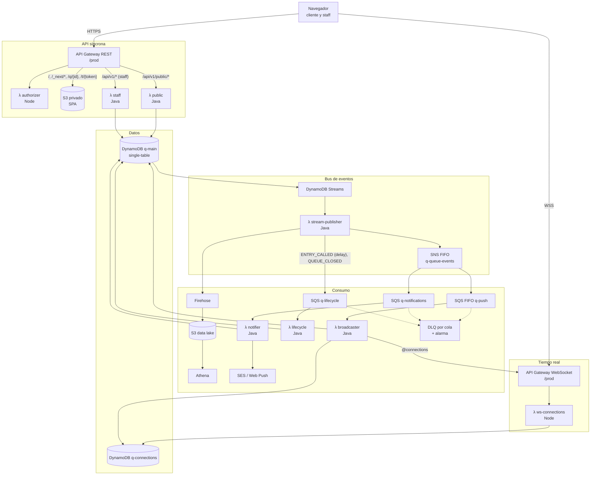
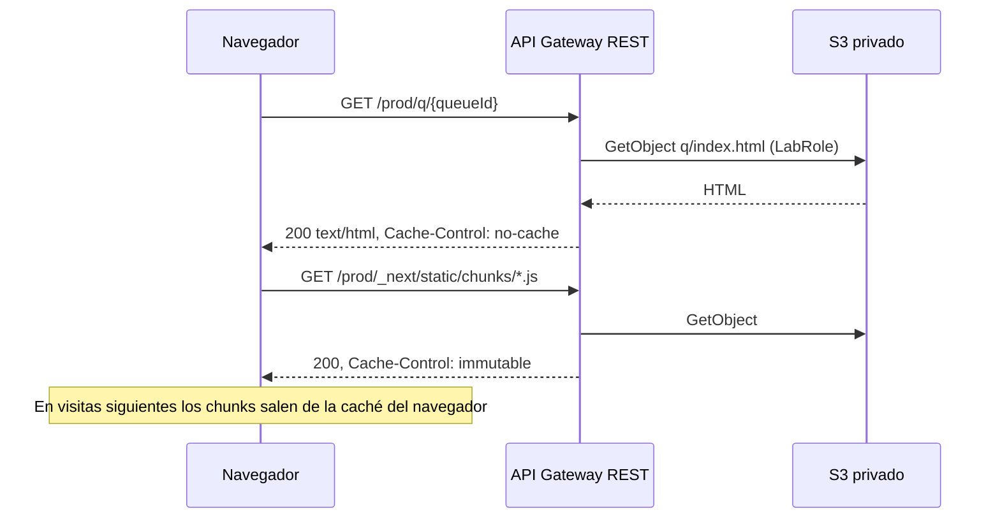
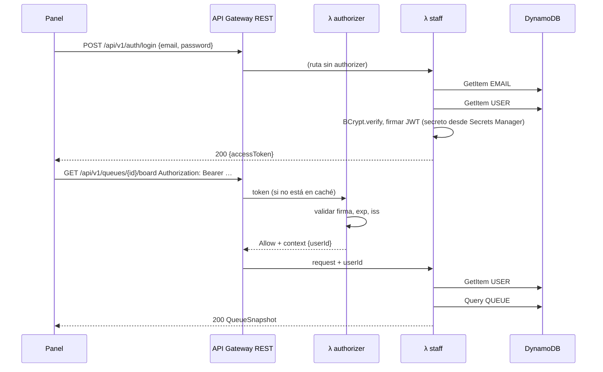
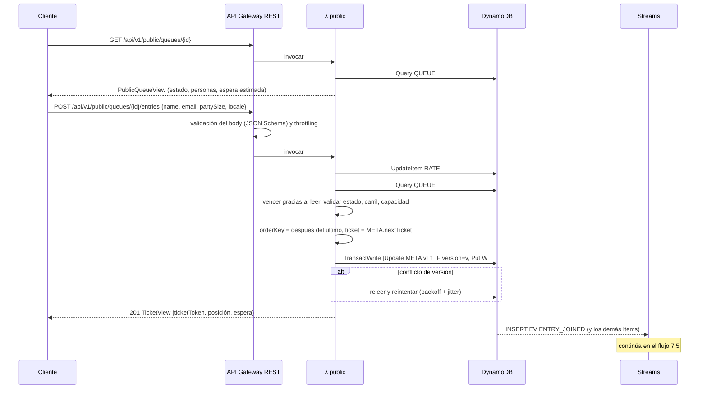
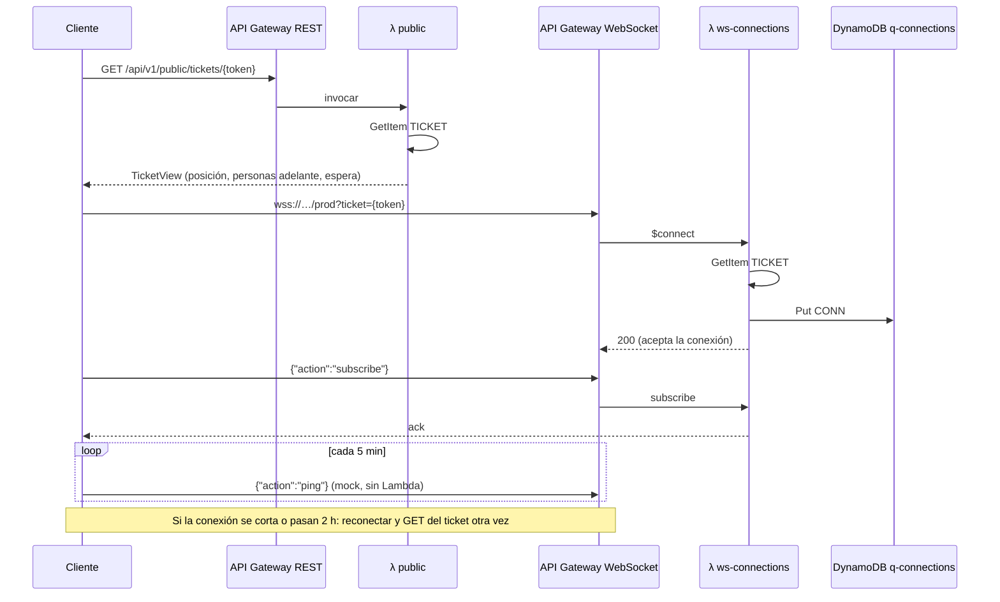
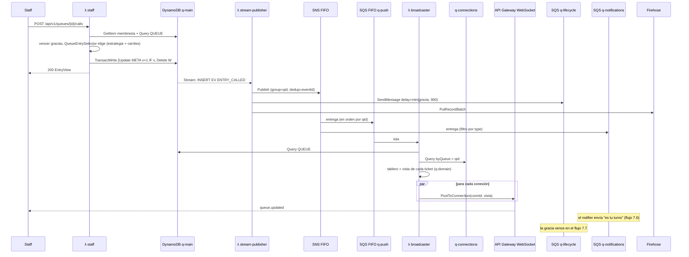
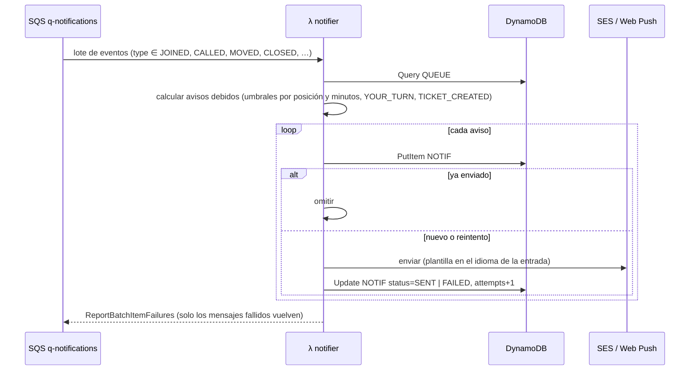
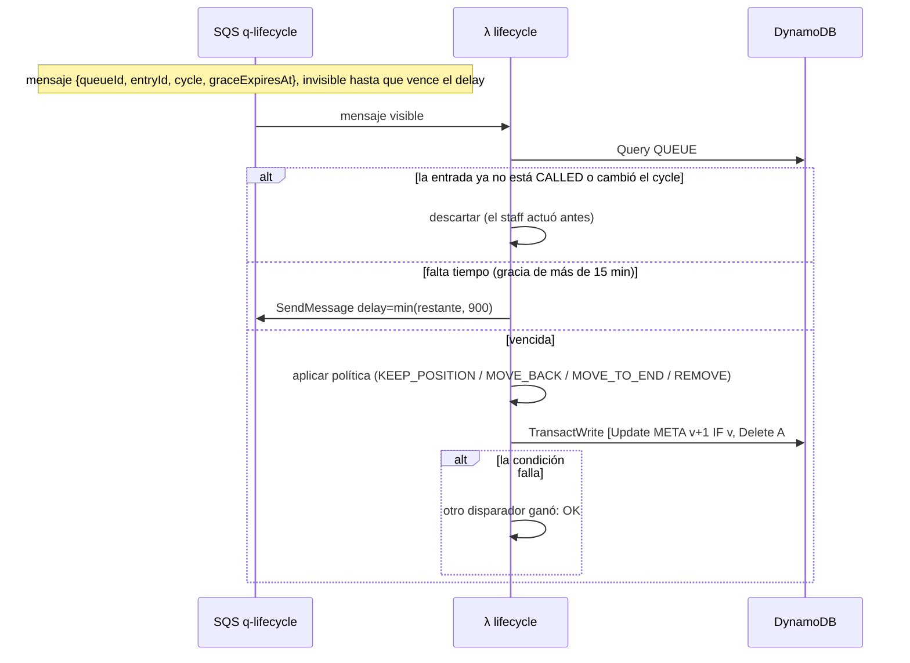
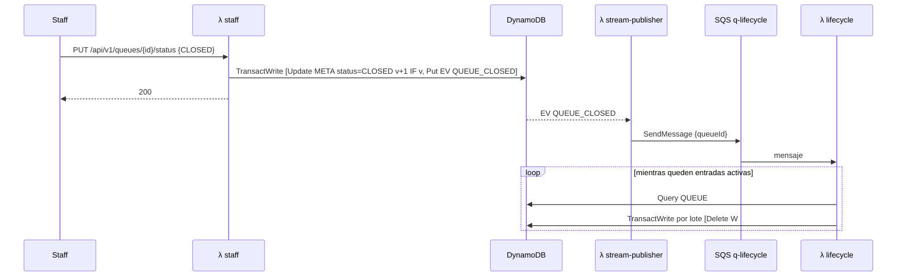

# Q: arquitectura serverless (versión AWS Academy)

> Diseño detallado de la arquitectura objetivo de Q: serverless, orientada a eventos, con
> DynamoDB, y adaptada a las restricciones del **AWS Academy Learner Lab** (sin dominio propio,
> sin CloudFront, sin creación de roles IAM y con concurrencia de Lambda limitada).
>
> Complementa a [propuesta-arquitectura-v2.md](../../propuesta-arquitectura-v2.md), que compara esta
> opción con las alternativas, y a [architecture.md](../architecture.md), que documenta el sistema
> actual. Las reglas de negocio (estados, políticas de no-show, carriles, estimación) no cambian:
> están en [domain-model.md](../domain-model.md).

---

## Índice

1. [Vista general](#1-vista-general)
2. [Restricciones de Academy y cómo se resuelven](#2-restricciones-de-academy-y-cómo-se-resuelven)
3. [Componentes](#3-componentes)
4. [Por qué las Lambdas están divididas así](#4-por-qué-las-lambdas-están-divididas-así)
5. [Modelo de datos en DynamoDB](#5-modelo-de-datos-en-dynamodb)
6. [Consistencia: qué se garantiza y cómo](#6-consistencia-qué-se-garantiza-y-cómo)
7. [Flujos detallados](#7-flujos-detallados)
8. [Manejo de fallas](#8-manejo-de-fallas)
9. [Presupuesto de concurrencia](#9-presupuesto-de-concurrencia)
10. [Configuración de cada función](#10-configuración-de-cada-función)
11. [Costos](#11-costos)
12. [Riesgos y pruebas previas](#12-riesgos-y-pruebas-previas)

---

## 1. Vista general


El mismo diagrama en Mermaid, con las rutas y las etiquetas de cada conexión:



La idea en una frase: **DynamoDB es la única fuente de verdad, y todo lo que no es responder una
solicitud reacciona a sus cambios.** Las Lambdas de la API escriben y responden; todo lo demás
(avisos, push en vivo, vencimiento de gracia, analítica) es asíncrono, reintentable e idempotente.

Transversales: **Secrets Manager** (secreto del JWT, claves VAPID de Web Push), **CloudWatch**
(logs, métricas, alarmas, X-Ray), **SNS q-alerts** (avisa por email al equipo cuando una DLQ
recibe mensajes) y **LabRole** como rol de ejecución de todo.

---

## 2. Restricciones de Academy y cómo se resuelven

| Restricción | Consecuencia | Decisión |
|---|---|---|
| No se pueden comprar dominios ni emitir certificados | No hay Route 53 ni ACM | Se usan las URLs `https://<id>.execute-api.us-east-1.amazonaws.com/prod`, que ya traen TLS |
| Sin CloudFront (decisión del equipo) | No hay CDN ni un único origen para SPA y API | **API Gateway REST sirve ambas cosas** (§3.1) |
| No se pueden crear roles IAM | Todo corre con `LabRole` | Los permisos no se pueden acotar por función. Esto afecta cómo se dividen las Lambdas (§4) |
| Concurrencia de Lambda baja (suele ser 10) | Las ejecuciones simultáneas se agotan rápido | Presupuesto explícito por función con `MaximumConcurrency` en las colas (§9) |
| No está confirmado que funcionen EventBridge Pipes ni WAF | No se puede depender de ellos | `λ stream-publisher` reemplaza a Pipes. El rate limiting se hace en API Gateway y en la aplicación (§3.1) |
| SES y SMS en sandbox | Solo se puede escribir a direcciones verificadas | Web Push como canal principal y email como respaldo |
| Sesiones de 4 h, credenciales que rotan | No hay CI/CD con claves permanentes | Se despliega con SAM o CloudFormation desde la máquina local. Lambda y DynamoDB persisten entre sesiones y no cobran sin uso |

---

## 3. Componentes

### 3.1 Entrada: API Gateway REST

Un solo API REST, stage `prod`, con dos familias de recursos:

| Recurso | Integración | Notas |
|---|---|---|
| `/` y `/{proxy+}` (archivos estáticos) | **Integración AWS con S3** (`GetObject`), con `LabRole` como credencial | El bucket es privado. Los archivos con hash de Next se sirven con `Cache-Control: public, max-age=31536000, immutable` y el HTML con `no-cache` |
| `/q/{queueId}` | S3 → `q/index.html` | URL limpia para el QR, sin ninguna regla de reescritura |
| `/t/{ticketToken}` | S3 → `t/index.html` | URL limpia para el link del ticket |
| `/api/v1/public/*` | Lambda proxy → `λ public` | Sin authorizer: el ticket token es la credencial |
| `/api/v1/*` (resto) | Lambda proxy → `λ staff` | Con `λ authorizer` (TOKEN, caché de 300 s) salvo `/auth/login` y `/auth/register` |

Consecuencias:

- **Mismo origen para la SPA y la API: no hace falta CORS.** El frontend sigue usando URLs relativas
  como hoy (`NEXT_PUBLIC_API_URL` vacío).
- La URL de un API REST incluye el stage, así que Next necesita **`basePath: '/prod'`** y
  `PUBLIC_BASE_URL` pasa a ser `https://<id>.execute-api.us-east-1.amazonaws.com/prod`.
- **Rate limiting en dos capas**, porque WAF no está garantizado en Academy:
  1. *Throttling* por método en API Gateway (por ejemplo, `POST /public/queues/{id}/entries`
     con un *rate* bajo y un *burst* chico).
  2. Límite por IP en `λ public`: un `UpdateItem` atómico con `ADD n :1` sobre `RATE#<ip>#<minuto>`,
     con la condición `n < límite` y un TTL de 2 minutos. Si la condición falla, responde 429.
- REST permite **validar el body en el gateway** con un JSON Schema por método, así que los requests
  mal formados se rechazan sin invocar ninguna Lambda (y sin gastar concurrencia).

### 3.2 Tiempo real: API Gateway WebSocket

| Ruta | Destino | Qué hace |
|---|---|---|
| `$connect` | `λ ws-connections` | Valida la credencial y da de alta la conexión |
| `subscribe` | `λ ws-connections` | Asocia la conexión a una cola, ya sea como staff o como ticket |
| `$disconnect` | `λ ws-connections` | Borra la conexión |
| `ping` | Integración *mock* | Heartbeat del cliente cada 5 min, para no llegar al corte por inactividad de 10 min. No invoca ninguna Lambda |

Límites que el cliente debe manejar: **una conexión dura como máximo 2 h** (el cliente reconecta
solo) y **un mensaje no puede pasar de 128 KB** (el tablero de una cola grande debe quedar por debajo).

**Autenticación en `$connect`.** El `WebSocket` del navegador no permite agregar headers, así que:

- **Cliente:** pasa su `ticketToken` como query string. Ya es público en la URL de su ticket, así
  que no expone nada nuevo.
- **Staff:** primero pide `POST /api/v1/ws-tickets` (autenticado con su JWT) y recibe un **ticket de
  conexión de un solo uso que vence en 30 s**, guardado como `WSTICKET#<id>` con TTL. Ese ticket va
  en la query string de `$connect`, que lo **consume con un `DeleteItem` condicional**. Así el JWT
  nunca aparece en una URL ni en un log, y queda resuelto el problema documentado del
  `?access_token` actual.

### 3.3 Datos

- **`q-main`**: tabla single-table on-demand, con Streams (`NEW_AND_OLD_IMAGES`) y PITR activado.
  Modelo en §5.
- **`q-connections`**: conexiones WebSocket. PK `CONN#<connectionId>`, GSI `byQueue` (PK `queueId`)
  y TTL de 2 h 10 min.

### 3.4 Bus de eventos

- **DynamoDB Streams** emite cada cambio de `q-main`.
- **`λ stream-publisher`** filtra solo los **ítems de evento** (§6.2) y los envía a sus destinos:

| Evento | Destino | Motivo |
|---|---|---|
| Todos | **SNS FIFO `q-queue-events`** (`MessageGroupId = queueId`, `MessageDeduplicationId = eventId`) | Fan-out ordenado por cola |
| Todos | **Firehose** (`PutRecordBatch`) → S3 → Athena | Los tópicos FIFO solo entregan a SQS, así que Firehose se alimenta desde acá |
| `ENTRY_CALLED` | **SQS `q-lifecycle`** con `DelaySeconds = min(graceRemaining, 900)` | SNS no permite un delay distinto por mensaje |
| `QUEUE_CLOSED` | **SQS `q-lifecycle`** sin delay | Libera la fila en lotes |

- **SNS FIFO** entrega a dos colas:
  - `q-push` (SQS FIFO) → `λ broadcaster`;
  - `q-notifications` (SQS standard, con filtro por `type`) → `λ notifier`.

  SNS desacopla: un consumidor nuevo (un webhook a un sistema de caja, auditoría) es una
  suscripción más, sin tocar la Lambda publicadora.

### 3.5 Consumidores

| Función | Lee de | Hace |
|---|---|---|
| `λ broadcaster` | `q-push` | Arma el tablero y la vista de cada ticket, y los empuja por `@connections` |
| `λ notifier` | `q-notifications` | Decide qué avisos corresponden, los deduplica y los envía por SES o Web Push |
| `λ lifecycle` | `q-lifecycle` | Aplica las mutaciones que dispara el sistema y no una persona: vencimiento de gracia y liberación masiva al cerrar una cola |
| Firehose | stream-publisher | Agrupa los eventos, los convierte a Parquet y los escribe en `s3://q-lake/events/dt=YYYY-MM-DD/` |

> En [propuesta-arquitectura-v2.md](../../propuesta-arquitectura-v2.md) esta función se llamaba `λ grace`.
> Se renombra porque también maneja el cierre de colas: las dos son mutaciones disparadas por el
> sistema con la misma lógica de dominio.

---

## 4. Por qué las Lambdas están divididas así

### 4.1 Las funciones

| # | Función | Disparador | Lenguaje | Responsabilidad |
|---|---|---|---|---|
| 1 | `authorizer` | API Gateway REST | Node | Validar el JWT del staff |
| 2 | `public` | API Gateway REST | Java + SnapStart | Join, ver y abandonar ticket, vista pública de la cola, QR |
| 3 | `staff` | API Gateway REST | Java + SnapStart | Login, registro, establecimientos, colas, carriles, tablero, acciones, métricas, ws-tickets |
| 4 | `ws-connections` | API Gateway WebSocket | Node | `$connect`, `$disconnect`, `subscribe` |
| 5 | `stream-publisher` | DynamoDB Streams | Java | Enrutar eventos de dominio |
| 6 | `broadcaster` | SQS FIFO `q-push` | Java + SnapStart | Push en vivo |
| 7 | `notifier` | SQS `q-notifications` | Java + SnapStart | Avisos a clientes |
| 8 | `lifecycle` | SQS `q-lifecycle` | Java + SnapStart | Gracia vencida y cierre de colas |

### 4.2 Criterios evaluados

| Criterio | Cómo quedaría | Veredicto |
|---|---|---|
| **Una Lambda por endpoint** | ~40 funciones | ❌ Cada función mantiene sus propias instancias calientes. Con tráfico moderado, casi todas arrancan en frío, y en Java eso son segundos. La lógica de dominio quedaría replicada en 40 paquetes. Su ventaja real, permisos mínimos por función, **no existe en Academy** porque todas usan `LabRole`. |
| **Una sola Lambda para toda la API** | Todo junto | Casi gana: es la que menos arranques en frío tiene. Pierde porque mezcla el tráfico anónimo y en ráfagas de los clientes con el del staff, carga en el camino del cliente todo el código del panel y obliga a una única configuración de memoria, timeout y alarmas. |
| **Por entidad o paquete** | queues / entries / establishments | ❌ Separa lo que se modifica junto: llamar a alguien modifica la entrada **y** el ítem `META` de su cola en la misma transacción. Las funciones quedarían acopladas por los datos. |
| **Lecturas contra escrituras (CQRS)** | GETs / comandos | ❌ Tiene sentido con un almacén de lectura distinto, pero acá se lee y escribe la misma tabla. El join (escritura) y el ticket (lectura) son del mismo usuario y tienen el mismo perfil de carga. |
| **Por tipo de disparador** | Una por fuente de eventos | ✅ Lo impone la plataforma (§4.3). |
| **Por audiencia, dentro de la API** | public / staff | ✅ Es el único corte que cambia el perfil de ejecución (§4.4). |

### 4.3 Primer corte: por disparador (obligatorio)

Cada fuente de eventos de Lambda trae **semántica propia y no negociable**:

| Fuente | Modelo | Reintentos | Configuración propia |
|---|---|---|---|
| API Gateway | Síncrono: alguien espera la respuesta | Ninguno: el error vuelve al cliente | Timeout ≤ 29 s |
| DynamoDB Streams | Por lotes, en orden por shard | Bloquea el shard hasta que el lote se procesa o el registro expira | `BisectBatchOnFunctionError`, destino en caso de falla |
| SQS FIFO | Por lotes, en orden por grupo | El mensaje vuelve a la cola y bloquea su grupo | Visibility timeout, `maxReceiveCount`, DLQ |
| SQS standard | Por lotes, sin orden | El mensaje vuelve a la cola | Ídem, más `MaximumConcurrency` |

Mezclar dos fuentes en una función obliga a configurar timeout, memoria y concurrencia para la peor
de las dos, y une sus fallas: un error que bloquea el stream no tiene por qué frenar el push. Por eso
**cada cola tiene su consumidor**. Es también lo que aísla las fallas: si SES está caído, los
reintentos de `notifier` no frenan a `broadcaster`.

`ws-connections` agrupa `$connect`, `$disconnect` y `subscribe` porque **comparten disparador,
tabla y perfil** (pocas líneas, latencia crítica). Separarlas solo triplicaría los arranques en frío.

### 4.4 Segundo corte: por audiencia (solo en la API síncrona)

| | `λ public` | `λ staff` |
|---|---|---|
| Quién la usa | Clientes anónimos, cientos por cola | Staff con sesión, unas pocas personas por local |
| Patrón de carga | Ráfagas cuando muchos escanean el QR a la vez | Constante y bajo |
| Sensibilidad a la latencia | Alta: es la primera impresión del producto | Media |
| Código que carga | Join, ticket, salir, vista pública, QR | Todo el panel |
| Exposición | Abierta a internet, con rate limiting | Detrás del authorizer |
| Alarmas | p95 de latencia, 429s | Errores 5xx |

**`auth` va dentro de `staff`** y no como función aparte: el login ocurre unas pocas veces por turno,
así que una función propia casi siempre arrancaría en frío. Además comparte el modelo de usuarios y
membresías con el resto del panel.

### 4.5 Tercer criterio: el lenguaje según la frecuencia de arranques en frío

- **Node** para `authorizer` y `ws-connections`. Son unas pocas decenas de líneas, están en el
  camino crítico de cada conexión y de cada request del staff sin caché, y arrancan en ~200 ms
  contra los segundos de una JVM.
- **Java + SnapStart** para todo lo que usa la lógica de dominio. SnapStart restaura una instantánea
  de la JVM ya inicializada, y con eso el arranque en frío baja a menos de un segundo.

Para no duplicar lógica, el código Java se organiza en módulos Maven:

```
q-domain/          lógica pura, sin AWS ni Spring: estados, QueueOrdering (claves fraccionarias),
                   QueueEntrySelector, EstimationService, políticas de no-show, vistas
q-dynamo/          repositorios sobre el AWS SDK v2 (DynamoDB Enhanced Client)
q-fn-public/       handler + wiring           ┐
q-fn-staff/        handler + wiring           │ cada uno empaqueta q-domain + q-dynamo
q-fn-broadcaster/  handler + wiring           │ y solo sus propios handlers
q-fn-notifier/     handler + wiring           │
q-fn-lifecycle/    handler + wiring           │
q-fn-publisher/    handler + wiring           ┘
```

Las funciones no usan Spring Boot: el arranque de Spring es justo lo que se quiere evitar en Lambda.
La inyección de dependencias es manual (o con Dagger, que resuelve todo en compilación). Las clases de
lógica pura del backend actual pasan a `q-domain`. Las que hoy dependen de JPA se reescriben sobre
`q-dynamo`.

### 4.6 Lo que dividir **no** cuesta

La concurrencia se cuenta **por ejecución simultánea, no por función**: tener 8 funciones no consume
más que tener 1. Lo que sí cuesta dividir es fragmentar las instancias calientes, y por eso se
dividió solo donde la plataforma o el perfil de carga lo justifican.

---

## 5. Modelo de datos en DynamoDB

### 5.1 Tabla `q-main`

| Entidad | PK | SK | Atributos clave |
|---|---|---|---|
| Cola (meta) | `QUEUE#<qid>` | `META` | `version`, `status`, `nextTicket`, `activeCount`, `activePersons`, configuración, `rrCursor`, `serviceTimes` (últimos N), `establishmentId` |
| Carril | `QUEUE#<qid>` | `LANE#<laneId>` | banda, prioridad, `capacityMode`, `timeFactor`, `active`, `deletedAt` |
| Entrada esperando | `QUEUE#<qid>` | `W#<orderKey>` | `entryId`, `ticketNumber`, `laneId`, `partySize`, contacto, `locale`, `cycle`, `joinedAt` |
| Entrada activa | `QUEUE#<qid>` | `A#<entryId>` | ídem más `status` (CALLED/SERVING), `calledAt`, `graceExpiresAt`, `orderKey` original |
| Entrada terminada | `QUEUE#<qid>` | `F#<finishedAt>#<entryId>` | ídem más `status` final y duración del servicio |
| Ticket | `TICKET#<token>` | `TICKET` | `queueId`, `entryId`, `sk` actual de la entrada |
| Evento de dominio | `QUEUE#<qid>#EV` | `<version:012d>#<eventId>` | `type`, `entryId`, `cycle`, `payload`, TTL de 30 días |
| Notificación | `ENTRY#<eid>` | `NOTIF#<type>#<cycle>` | `status` (PENDING/SENT/FAILED), `channel`, `attempts`, `sentAt` |
| Usuario | `USER#<uid>` | `PROFILE` | nombre, hash BCrypt |
| Unicidad de email | `EMAIL#<email>` | `EMAIL` | `userId` |
| Membresía | `USER#<uid>` | `EST#<eid>` | `role` |
| Miembros del local | `EST#<eid>` | `MEMBER#<uid>` | `role` (copia invertida, en la misma transacción) |
| Establecimiento | `EST#<eid>` | `META` | nombre, zona horaria |
| Colas del local | `EST#<eid>` | `QUEUE#<qid>` | nombre, estado (para el listado) |
| Rate limit | `RATE#<ip>#<minuto>` | `RATE` | `n`, TTL de 2 min |
| Ticket de WebSocket | `WSTICKET#<id>` | `WSTICKET` | `userId`, TTL de 30 s |

### 5.2 Decisiones

- **El estado está codificado en la SK.** Un `Query` con `begins_with(SK, "W#")` devuelve la fila de
  espera **ya ordenada**, y la posición de alguien es su índice en ese resultado. Las posiciones
  siguen sin guardarse, igual que hoy.
- **Cambiar de estado es mover el ítem**: `Delete` de la SK vieja más `Put` de la nueva dentro de la
  misma transacción, y se actualiza el puntero `TICKET#`.
- **Claves de orden fraccionarias** (strings, estilo LexoRank) en lugar de enteros separados de a
  1000. Entre dos strings siempre existe otro, así que **la renormalización desaparece**. En DynamoDB
  sería cara, porque una transacción admite como máximo 100 ítems.
- **Sin índices secundarios en los caminos críticos.** Los GSI son siempre eventualmente
  consistentes, así que login, ticket y membresía se resuelven con ítems de búsqueda (`EMAIL#`,
  `TICKET#`, `USER#/EST#`) que se leen con **lectura fuertemente consistente**.
- **El promedio de servicio se guarda incremental**: `serviceTimes` en `META` conserva las últimas N
  duraciones y se actualiza en la misma transacción que marca a alguien como atendido. No hace falta
  agregar al leer.
- **Las métricas del día no necesitan agregados precalculados**: `Query` de `F#` entre el inicio y el
  fin del día (en la zona horaria del establecimiento). Lo histórico va por Athena.

### 5.3 Tabla `q-connections`

| PK | Atributos | GSI `byQueue` |
|---|---|---|
| `CONN#<connectionId>` | `queueId`, `kind` (STAFF/TICKET), `userId` o `ticketToken`, `connectedAt`, `ttl` | PK `queueId`: **una sola consulta** devuelve todas las conexiones interesadas en una cola |

---

## 6. Consistencia: qué se garantiza y cómo

El sistema mezcla **consistencia fuerte** donde un error se vería (la fila, los números de ticket, la
capacidad) y **consistencia eventual** donde un retraso de milisegundos es invisible (push, avisos,
analítica). La tabla resume cada caso. El detalle está debajo.

| Dato o interacción | Garantía | Mecanismo |
|---|---|---|
| Nadie es llamado dos veces; ticket sin repetir; capacidad respetada | **Fuerte, serializable** | `TransactWriteItems` condicionado a `META.version` (§6.1) |
| Después de unirse, el cliente ve su ticket | **Lee lo que escribió** | Lecturas fuertemente consistentes sobre la tabla base |
| Toda mutación confirmada genera su evento, y ninguna fallida lo hace | **Atómica** | El evento es un ítem más de la misma transacción (outbox en la tabla, §6.2) |
| Orden de los eventos de una cola | **Ordenado por cola** | Una sola partición por cola en el stream, `version` en la SK y SNS/SQS FIFO por `queueId` (§6.3) |
| Push en vivo | **Eventual, a lo sumo una vez por conexión** | El broadcaster siempre lee el estado actual y el cliente recupera lo perdido con REST (§6.4) |
| Avisos al cliente | **Al menos una vez, con deduplicación** | Escritura condicional de `NOTIF#type#cycle` (§6.5) |
| Vencimiento de gracia | **Exactamente un efecto** | Condición sobre `status` y `cycle`, más vencimiento al leer (§6.6) |
| Revocar el acceso de un miembro del staff | **Inmediata** | La membresía se lee en cada request y no viaja en el JWT |
| Conexiones de una cola | **Eventual (GSI)** | La primera vista llega por REST, no por el push (§6.4) |
| Analítica | **Eventual (minutos)** | Firehose agrupa por tiempo |

### 6.1 Concurrencia sobre una cola: control optimista

Hoy cada mutación toma `SELECT … FOR UPDATE` sobre la fila de la cola. En DynamoDB no hay locks.
El equivalente es **control optimista con versión**:

1. Leer `META` (lectura consistente) y lo que haga falta de la cola. Guardar `v = META.version`.
2. Calcular la mutación en memoria con `q-domain`.
3. Ejecutar un `TransactWriteItems` que incluya:
   - `Update META SET version = v + 1, … CONDITION version = :v`;
   - los `Put`/`Delete` de las entradas afectadas;
   - el `Put` del ítem de evento (§6.2).
4. Si falla con `TransactionCanceledException` porque la condición de `META` no se cumplió, otro
   escritor ganó: **volver al paso 1** con backoff exponencial y jitter, hasta 5 intentos. Si se
   agotan, responder `409 CONCURRENT_MODIFICATION` y el frontend reintenta.

Las transacciones de DynamoDB son **serializables entre sí**, así que dos personas del staff que
presionan "llamar" al mismo tiempo producen exactamente un llamado: la segunda reintenta, relee y
ve que la primera entrada ya no está esperando. Las cuatro carreras de §7.1 de `architecture.md`
quedan cubiertas de la misma forma:

| Carrera | Resultado |
|---|---|
| Dos personas del staff llaman a la vez | Una transacción gana. La otra reintenta y llama a la siguiente persona |
| Dos clientes se unen a la vez | `nextTicket` se lee bajo la versión, así que salen 7 y 8 |
| Un vencimiento de gracia coincide con una acción del staff | Una gana; la otra relee y ve el estado nuevo |
| Un join compite con el chequeo de `maxSize` | `activeCount` se lee bajo la versión |

**Contención.** Todas las escrituras de una cola compiten por la misma versión. Una transacción tarda
~10–20 ms, así que una cola soporta decenas de mutaciones por segundo con pocos reintentos, muy por
encima del ritmo humano de una fila. Para una ráfaga extrema (cientos de escaneos del QR en un
segundo) hay una variante documentada: encolar los joins en una SQS FIFO con `MessageGroupId =
queueId`, de modo que haya **un solo escritor por cola**, y devolver el ticket por WebSocket. No se
implementa salvo que las pruebas de carga lo pidan.

**Límite de 100 ítems.** Ninguna operación normal se acerca: un llamado toca unos 4 ítems (META,
Delete W#, Put A#, TICKET#, evento). Solo el cierre de una cola con muchas personas lo superaría, y
por eso se hace en lotes desde `λ lifecycle` (flujo 7.9).

### 6.2 Escritura dual resuelta: el evento es un ítem de la transacción

El problema clásico es guardar el cambio y publicar el evento sin que pueda pasar solo uno de los
dos. Acá **el evento se escribe como un ítem `QUEUE#<qid>#EV` dentro de la misma transacción** que
el cambio, y `stream-publisher` publica **solo** los `INSERT` de esos ítems.

- Si la transacción falla, no hay ítem de evento, así que no se publica nada: nunca se anuncia un
  cambio que no ocurrió.
- Si la transacción se confirma, el ítem aparece en el stream, y **cada registro aparece exactamente
  una vez** en el stream. Lo que puede repetirse es su procesamiento: si `stream-publisher` falla a
  mitad de un lote, Lambda reintenta el lote completo. Ese duplicado lo absorbe la deduplicación de
  SNS FIFO (`MessageDeduplicationId = eventId`, ventana de 5 min), y en `q-lifecycle` la condición
  sobre `cycle` (§6.6).
- No hace falta tabla outbox, ni poller, ni un barrido de pendientes: es el patrón *transactional
  outbox* donde DynamoDB hace de relay.
- Hay una razón más para no leer los demás ítems de la transacción: **Streams no agrupa los
  registros de una transacción**, porque cada ítem modificado es un registro separado y puede caer
  en lotes distintos. Publicar desde un único ítem de evento por cambio evita reconstruir
  transacciones a medias.
- Los ítems de evento también son la **auditoría** (lo que hoy es `queue_event`), con TTL de 30 días
  en la tabla y la copia permanente en el data lake.

### 6.3 Orden

- Todos los eventos de una cola comparten la partición `QUEUE#<qid>#EV` y llevan `version` en la SK.
  DynamoDB documenta el orden de Streams **por ítem**, no entre ítems distintos. Por eso
  `stream-publisher` ordena cada lote por `(queueId, version)` antes de publicar, y el diseño no
  necesita un orden estricto para ser correcto: los consumidores siempre evalúan el estado actual
  (ver más abajo).
- SNS FIFO y la SQS FIFO `q-push` mantienen ese orden **por `MessageGroupId = queueId`**, y Lambda
  procesa un solo lote por grupo a la vez. Esto reproduce exactamente lo que hoy hace a mano
  `BroadcastCoordinator`: un refresh por cola en curso, varias colas en paralelo.
- `q-notifications` y `q-lifecycle` son standard (sin orden), **a propósito**: sus consumidores no
  dependen del orden porque cada mensaje se evalúa contra el estado actual (§6.5, §6.6).
- Cada evento lleva la `version` de la cola. Un consumidor que necesite descartar algo viejo compara
  contra `META.version`. Con el diseño actual ninguno lo necesita.

### 6.4 Push en vivo: eventual y autocorregible

- `broadcaster` **no aplica deltas, siempre relee el estado actual** con lecturas consistentes. Un
  evento duplicado, tardío o fuera de orden puede provocar un push redundante, **nunca una pantalla
  incorrecta**. Es la misma propiedad que tiene hoy LISTEN/NOTIFY.
- Si un lote trae varios eventos de la misma cola, se agrupan y se hace **un solo** refresh. Esto
  reemplaza la ventana de coalescing de 200 ms.
- `PostToConnection` puede fallar para una conexión puntual (red móvil, socket cerrado). No se
  reintenta: el cliente detecta el corte, reconecta y **vuelve a leer por REST** (lo que ya hace
  `useLiveResource`). Mientras el WebSocket está caído, sigue funcionando el polling de respaldo.
- El GSI `byQueue` es eventual: una conexión recién suscripta puede perderse el primer push. No
  importa, porque **la primera vista siempre llega por REST**, antes de suscribirse.
- La regla del frontend "un número monótono ordena cada escritura sobre un recurso vivo" (decisión 23
  de `architecture.md`) sigue valiendo: si una respuesta de polling llega después de un push más
  nuevo, se descarta.

### 6.5 Avisos: al menos una vez, con deduplicación

SQS standard entrega **al menos una vez**, y Lambda puede reintentar. Para que un cliente no reciba
dos veces "es tu turno":

1. `notifier` arma la lista de avisos que corresponden según el **estado actual** de la cola, no
   según el evento.
2. Para cada uno, hace un `PutItem NOTIF#<type>#<cycle>` con la condición
   `attribute_not_exists(PK) OR status = FAILED`.
3. Si la condición falla y el aviso ya figura como `SENT`, no envía nada.
4. Envía por el canal que corresponda y actualiza a `SENT` (o a `FAILED` con `attempts + 1`).

Hay un caso residual que **no se puede eliminar**: si la Lambda muere después de enviar y antes de
marcar `SENT`, el reintento vuelve a enviar. Ningún sistema puede hacer exactamente una vez un envío
hacia un proveedor externo sin una clave de idempotencia del lado del proveedor. Es aceptable porque
un mail duplicado es mucho mejor que uno perdido, y ocurre solo ante una caída en ese instante
preciso.

`cycle` sigue funcionando igual que hoy: si alguien es llamado, no aparece, vuelve a la fila y es
llamado otra vez, `cycle` aumenta y recibe un segundo "es tu turno" legítimo.

### 6.6 Gracia: un solo efecto aunque haya varios disparadores

El vencimiento puede dispararse desde tres lugares, y los tres usan la misma función de `q-domain`:

1. **`λ lifecycle`**, cuando se libera el mensaje con delay.
2. **Cualquier lectura** (`public` o `staff`) que encuentre un `A#` con `graceExpiresAt <= now`: es
   el vencimiento al leer que existe hoy, que garantiza que nadie vea un llamado ya vencido.
3. **`λ staff`** antes de cualquier mutación sobre la cola.

Todos ejecutan la misma transacción, con la condición `status = CALLED AND cycle = :c` más la
versión de `META`. **El primero gana y los demás fallan la condición, lo que se interpreta como
"ya estaba hecho"** y no como un error. Si el staff atendió a la persona un segundo antes de que se
dispare el delay, la condición falla y el mensaje se descarta.

---

## 7. Flujos detallados

### 7.1 Carga de la aplicación



1. El QR apunta a `https://<id>.execute-api.us-east-1.amazonaws.com/prod/q/<queueId>`.
2. API Gateway resuelve el recurso `/q/{queueId}` con la integración a S3, que devuelve siempre
   `q/index.html` (el *shell* de la SPA).
3. Los chunks de Next tienen hash en el nombre, así que se cachean un año en el navegador. Solo el
   HTML se revalida.
4. La SPA arranca, lee `queueId` de la URL y continúa en el flujo 7.3.

### 7.2 Login del staff y requests autenticados



- **Login:** `staff` resuelve el email con el ítem `EMAIL#` (lectura consistente, sin GSI), verifica
  BCrypt y firma el JWT con HS256. El secreto se lee de Secrets Manager **una sola vez por
  instancia**, durante la inicialización, así que queda capturado en la instantánea de SnapStart.
- **Registro:** una transacción con `Put EMAIL#` (condición `attribute_not_exists`, que garantiza la
  unicidad), `Put USER#/PROFILE` y, si crea un establecimiento, `Put EST#/META`, `Put USER#/EST#` y
  `Put EST#/MEMBER#`.
- **Requests:** el authorizer valida **identidad** (firma, vencimiento, emisor) y su respuesta se
  cachea 300 s por token. La **autorización** (si es miembro de ese establecimiento y con qué rol) la
  resuelve `staff` en cada request leyendo la membresía. Así revocar a alguien tiene efecto inmediato,
  igual que hoy.
- **JWT vencido:** el authorizer responde 401, y el frontend cierra la sesión (decisión 24 de
  `architecture.md`).

### 7.3 El cliente ve la cola y se une



1. **Vista pública:** un `Query` de la partición de la cola devuelve `META` y las entradas que
   esperan. Con eso `public` calcula la cantidad de personas y la espera estimada usando
   `EstimationService` de `q-domain`. La página sigue consultando cada 15 s mientras está visible
   (decisión 25 de `architecture.md`).
2. **Join:**
   - API Gateway rechaza el body mal formado y aplica el *throttling* **sin invocar** la Lambda.
   - `public` aplica el límite por IP.
   - Relee la cola con lecturas consistentes y aplica gracias vencidas si las hay (§6.6).
   - Valida que la cola esté abierta, que exista un carril cuya banda incluya `partySize`, que haya
     capacidad (según `capacityMode`) y que haya un canal de contacto.
   - Genera la clave de orden fraccionaria posterior a la última y toma `nextTicket`.
   - Escribe todo en **una transacción**, que incluye el ítem de evento `ENTRY_JOINED`.
3. **Respuesta:** `201` con el `ticketToken`. La SPA navega a `/t/<token>`.
4. **Asíncrono:** el evento dispara el aviso `TICKET_CREATED` con el link al ticket (flujo 7.6) y
   el push al tablero del staff (flujo 7.5).

### 7.4 El cliente sigue su turno en vivo



1. **Primero REST, después WebSocket.** `EventSource` y `WebSocket` no informan códigos HTTP, así que
   un ticket inexistente se detecta con el `GET` y se muestra "este ticket no existe" en lugar de un
   fallo de conexión silencioso. Es la misma decisión que ya toma `useLiveResource`.
2. **`$connect`:** `ws-connections` valida que el ticket exista y siga activo, y da de alta la conexión
   indexada por `queueId` (GSI `byQueue`).
3. **Durante la espera:** cada cambio en la cola llega como un push con el mismo formato que la
   respuesta REST (flujo 7.5).
4. **Desconexión:** `$disconnect` borra la conexión. Si ese evento se pierde (no siempre llega), el
   broadcaster la borra cuando `PostToConnection` responde `410 Gone`, y el TTL la limpia de todos
   modos.
5. **Respaldo:** si el WebSocket está caído, el cliente consulta por polling hasta reconectar.

**El staff** hace lo mismo con dos diferencias: primero pide un ticket de conexión de un solo uso
(`POST /api/v1/ws-tickets`, §3.2), y en `subscribe` indica el `queueId`, que `ws-connections` valida
contra la membresía antes de aceptar, porque el tablero contiene datos personales de los clientes.

### 7.5 El staff llama al siguiente (flujo completo de eventos)



Paso a paso:

1. **Comando:** `staff` verifica la membresía, relee la cola y aplica gracias vencidas.
   `QueueEntrySelector` elige a quién llamar según la estrategia de la cola (`GLOBAL_AGE`,
   `LANE_PRIORITY` o `ROUND_ROBIN`). Es la misma función que usa la estimación, así que la espera
   que se le anuncia a cada cliente sale de las mismas reglas que lo van a atender.
2. **Transacción:** la entrada pasa de `W#` a `A#`. Se calcula `graceExpiresAt`, se actualiza el
   puntero del ticket, se mueve `rrCursor` si la estrategia es round robin, se incrementa `version` y
   se escribe el evento `ENTRY_CALLED`. **El staff recibe la respuesta acá**: nada de lo que sigue la
   demora.
3. **Publicación:** `stream-publisher` recibe el registro del ítem de evento y lo manda a tres
   destinos: SNS (fan-out), `q-lifecycle` con delay (el timer de gracia) y Firehose (analítica).
4. **Push:**
   - SNS lo deja en `q-push`, y Lambda entrega lotes **de a uno por cola**.
   - `broadcaster` agrupa por `queueId`, lee la cola **una vez** y las conexiones **una vez**, y arma
     todas las vistas con `q-domain`: el tablero completo para el staff, posición y espera para cada
     ticket. Es la optimización de `readBroadcast` (§9.4 de `architecture.md`): el costo no crece con
     la cantidad de personas mirando.
   - Envía en paralelo con el cliente asíncrono del SDK. Cada push lleva solo lo que esa conexión
     puede ver: un cliente nunca recibe el tablero.
5. **Aviso y timer** siguen en los flujos 7.6 y 7.7.

Latencia esperable desde el commit hasta la pantalla: Streams (~100–300 ms), Lambda, SNS FIFO, SQS
FIFO (~50–100 ms) y el push. **Total: alrededor de 0,5–1 s**, invisible en la escala de tiempo de
una fila.

**Otras acciones del staff** (atender, marcar ausente, cancelar, volver a poner en la fila, pausar,
reanudar, editar configuración, gestionar carriles) siguen exactamente el mismo patrón: comando en
`staff`, transacción con el ítem de evento, y el resto es asíncrono. Al atender, además, se agrega la
duración a `META.serviceTimes` y la entrada pasa a `F#<finishedAt>`.

### 7.6 Avisos al cliente



- **Qué avisar se decide con el estado actual, no con el evento.** Cualquier movimiento de la cola
  puede hacer que alguien cruce un umbral ("faltan 3 personas", "faltan 10 minutos"), así que el
  notifier relee la cola y evalúa a todos los que esperan. Por eso no le importa el orden ni los
  duplicados: dos evaluaciones del mismo estado producen los mismos avisos, y la escritura
  condicional evita el segundo envío.
- **Por qué no se decide dentro de la transacción del comando** (como hoy): un movimiento puede
  hacer cruzar umbrales a decenas de personas, y meter un ítem `NOTIF#` por cada una superaría el
  límite de 100 ítems y haría la transacción del staff lenta y más propensa a conflictos.
- **Canal:** Web Push si el cliente aceptó notificaciones (la suscripción se guarda en la entrada),
  y si no email por SES. En Academy, SES solo entrega a direcciones verificadas.
- **Idioma:** el `locale` guardado en la entrada elige la plantilla, igual que hoy.
- **Fallas:** si un envío falla, el ítem queda `FAILED` y el mensaje vuelve a la cola
  (`ReportBatchItemFailures`). Después de 5 recepciones va a la DLQ y se dispara la alarma.

### 7.7 Vence el período de gracia



- **Políticas:** `KEEP_POSITION` vuelve a la fila con su clave original, `MOVE_BACK` con una clave
  fraccionaria entre las personas N y N+1, `MOVE_TO_END` después de la última y `REMOVE` pasa a
  `F#` como `NO_SHOW`. Al volver a esperar, `cycle` aumenta, lo que habilita un nuevo aviso
  "es tu turno" en el futuro.
- **`gracePeriodSeconds = 0`:** `stream-publisher` no encola nada y solo el staff decide, igual que
  hoy.
- **Precisión:** SQS libera el mensaje con precisión de segundos. Si hubiera un retraso, el
  vencimiento al leer (§6.6) garantiza que nadie vea un llamado que ya venció.
- Se reemplaza el `GraceSweepJob` actual, que hoy corre cada 10 s en **todas** las instancias.

### 7.8 El cliente abandona la fila

1. `DELETE /api/v1/public/tickets/{token}` → `λ public`.
2. `GetItem TICKET#token` y lectura de la cola.
3. Transacción: `Delete W#…` (o `A#…`), `Put F#…` con `LEFT`, `Update TICKET#`, `Update META`
   (`activeCount - 1`, `version + 1`) y `Put EV ENTRY_LEFT`.
4. Respuesta `204`. De forma asíncrona, todos los que estaban detrás reciben su nueva posición por
   push, y quien cruce un umbral recibe su aviso.

### 7.9 El staff cierra una cola



- **El cierre es atómico e inmediato:** en cuanto `META.status = CLOSED`, no se aceptan nuevos joins
  ni llamados.
- **La liberación es asíncrona y en lotes** de hasta 30 entradas por transacción (unos 3 ítems por
  entrada más `META`, dentro del límite de 100).
- Cada `ENTRY_LEFT` produce su aviso `QUEUE_CLOSED` y el push correspondiente. Si `lifecycle` falla a
  mitad de camino, SQS reintenta el mensaje y el `Query` encuentra solo las entradas que faltan:
  **la operación es idempotente por construcción**.

### 7.10 Métricas

- **Hoy:** `GET /api/v1/establishments/{id}/metrics?range=today` → `λ staff` hace un `Query` por cola
  de `F#` entre el inicio y el fin del día en la zona horaria del establecimiento, y calcula atendidos,
  ausentes, abandonos y tiempos promedio con `MetricsService` de `q-domain`. No hay agregados
  precalculados.
- **Histórico:** Firehose escribe Parquet particionado por día en el data lake. Una tabla del
  catálogo de Glue (definida en la plantilla) permite consultar con Athena, por ejemplo la espera
  promedio por carril y por franja horaria del último mes. Es la respuesta a la limitación conocida
  "Métricas calculadas en Java sobre un set de filas".

### 7.11 Desconexiones y reconexión

| Situación | Qué pasa |
|---|---|
| El cliente cambia de red o bloquea el teléfono | El socket se cae. Al volver, la SPA reconecta y hace un `GET` del ticket, así que se pone al día |
| Se cumplen las 2 h de conexión | API Gateway cierra. El cliente reconecta solo y relee por REST |
| `$disconnect` no llega | El broadcaster recibe `410 Gone` y borra la conexión. El TTL la limpia igual |
| El WebSocket está bloqueado por la red | El polling de respaldo mantiene la pantalla correcta, con un retraso de segundos |

---

## 8. Manejo de fallas

| Falla | Efecto | Recuperación |
|---|---|---|
| Conflicto de versión en una escritura | Reintento transparente | Backoff + jitter, hasta 5 intentos; después `409` |
| Throttling de concurrencia de Lambda | `429` en la API | El frontend reintenta con backoff. Las colas asíncronas tienen techo (§9) y no compiten |
| `stream-publisher` falla | El shard queda bloqueado, porque Streams retiene 24 h | `BisectBatchOnFunctionError` aísla el registro problemático. Tras `MaximumRetryAttempts` va a una SQS de fallas con alarma |
| SNS no disponible | `stream-publisher` falla y Streams reintenta | No se pierde nada: el evento sigue en el stream 24 h |
| `broadcaster` falla | El grupo FIFO de esa cola queda bloqueado, las otras colas siguen | Reintentos y luego la DLQ. Los clientes siguen correctos por el polling de respaldo |
| SES caído o fuera del sandbox | Los avisos quedan `FAILED` | Reintentos SQS y luego la DLQ. Web Push no depende de SES |
| `lifecycle` falla | Una gracia no se aplica a tiempo | Reintento SQS. Mientras tanto, el vencimiento al leer la aplica en la próxima lectura |
| Un mensaje que siempre falla | Agota sus reintentos | DLQ → alarma de CloudWatch → SNS `q-alerts` → email al equipo. Se puede redirigir a la cola original una vez corregido |
| DynamoDB con throttling | Raro en on-demand, salvo picos de más del doble del pico previo en minutos | Los reintentos del SDK lo absorben |

Toda DLQ tiene una alarma de **profundidad > 0**, y `q-push` tiene otra sobre la **edad del mensaje
más viejo > 10 s**.

---

## 9. Presupuesto de concurrencia

Con el límite típico de Academy (10 ejecuciones simultáneas):

| Función | Techo | Cómo se impone |
|---|---|---|
| `stream-publisher` | 1 | Una ejecución por shard (con esta carga hay un solo shard) |
| `broadcaster` | 2 | `MaximumConcurrency = 2` en el event source mapping |
| `notifier` | 2 | Ídem. Los avisos pueden atrasarse unos segundos |
| `lifecycle` | 2 | Ídem. Es el mínimo que permite AWS |
| `public`, `staff`, `authorizer`, `ws-connections` | Lo que queda (≥ 3) | Pool compartido |

- **No se usa concurrencia reservada:** AWS exige dejar un mínimo sin reservar que, con un límite de
  10, no deja margen. En una cuenta normal (límite de 1000) se reservaría capacidad para `public` y
  `broadcaster`.
- 3 ejecuciones a ~100 ms cada una dan **~30 requests por segundo sostenidos**, suficiente para la demo.
  El cuello de botella es la cuenta, no la arquitectura. Conviene decirlo explícitamente en el
  informe.
- Validar los bodies en el gateway y cachear el authorizer **ahorran invocaciones**, que en este
  contexto es ahorrar concurrencia.

---

## 10. Configuración de cada función

| Función | Memoria | Timeout | Lote | Otros |
|---|---|---|---|---|
| `authorizer` | 256 MB | 3 s | — | Caché de 300 s en API Gateway |
| `public` | 1024 MB | 10 s | — | SnapStart, alias `live` |
| `staff` | 1024 MB | 15 s | — | SnapStart, alias `live` |
| `ws-connections` | 256 MB | 5 s | — | — |
| `stream-publisher` | 512 MB | 30 s | 100, ventana 0 s | `BisectBatchOnFunctionError`, 5 reintentos, destino de fallas en SQS, filtro solo `INSERT` de `QUEUE#*#EV` |
| `broadcaster` | 1024 MB | 30 s | 10 | Visibility timeout de `q-push` = 180 s, `maxReceiveCount` 5 |
| `notifier` | 512 MB | 30 s | 10 | `ReportBatchItemFailures`, visibility timeout 180 s |
| `lifecycle` | 1024 MB | 60 s | 5 | Visibility timeout 360 s |

- Más memoria en Lambda también da más CPU. Para Java, 1024 MB suele ser el punto donde el costo por
  invocación es más bajo, porque la función termina antes.
- El visibility timeout de cada cola es 6 veces el timeout de su función, como recomienda AWS, para
  que un mensaje no reaparezca mientras todavía se está procesando.
- SnapStart se aplica a versiones publicadas: los triggers apuntan al alias `live`.

---

## 11. Costos

Escenario de referencia: 100 establecimientos y 20.000 joins por día, en us-east-1. Son órdenes de
magnitud: hay que confirmarlos con AWS Pricing Calculator antes de citarlos.

| Componente | Estimación mensual |
|---|---|
| API Gateway REST (API + estáticos, con caché del navegador) | ~US$ 15–25 |
| API Gateway WebSocket (minutos de conexión + mensajes) | ~US$ 15 |
| Lambda (todas) | ~US$ 10–20 |
| DynamoDB on-demand (dos tablas) | ~US$ 10–20 |
| SNS + SQS | ~US$ 3–5 |
| Firehose + S3 + Athena | ~US$ 2–5 |
| Secrets Manager, CloudWatch | ~US$ 3–5 |
| **Total de infraestructura** | **~US$ 60–95 con carga, ~US$ 3–5 sin uso** |
| Emails (SES), si todo fuera por email | ~US$ 180 (Web Push no tiene costo por mensaje) |

Respecto del EC2 actual (~US$ 115 fijos), lo decisivo no es el total con carga sino el costo sin uso:
en un presupuesto de Academy de US$ 50, esta arquitectura puede quedar desplegada todo el
cuatrimestre.

---

## 12. Riesgos y pruebas previas

Antes de escribir código, dedicar una sesión del lab a confirmar lo que puede cambiar el diseño:

| Prueba | Cómo | Plan B si falla |
|---|---|---|
| Límite de concurrencia de Lambda | `aws lambda get-account-settings --query AccountLimit` | Si es menor que 10: unir `notifier` y `lifecycle` en una sola función con techo de 2 |
| API Gateway REST lee S3 con `LabRole` | Crear un recurso con integración a S3 y pedir un archivo | Servir la SPA desde una Lambda Node mínima (con caché agresiva en el navegador) |
| SnapStart disponible | Publicar una versión de una función Java con SnapStart | Java sin SnapStart y 1536 MB, o reescribir `public` en Node |
| SNS FIFO → SQS standard | Crear la suscripción | Hacer `q-notifications` FIFO también (con grupo por `queueId`) |
| Firehose escribe en S3 con `LabRole` | Crear el stream y hacer un `PutRecord` | `stream-publisher` escribe en S3 directo por lotes |
| SES en sandbox | Verificar los emails del equipo | Web Push solamente para la demo |

### Lo que se mantiene del sistema actual

- Todas las reglas de negocio: estados, carriles, estrategias de llamado, estimación, políticas de
  no-show y deduplicación por `(entry, type, cycle)`.
- La separación entre capacidad de cliente (ticket token) y JWT del staff, con autorización por
  membresía.
- El frontend estático, con su recurso vivo, su respaldo por polling y su número monótono por
  escritura. Lo que cambia es el transporte: de SSE a WebSocket.

### Lo que cambia

| Hoy | Acá |
|---|---|
| `SELECT … FOR UPDATE` por cola | Control optimista con `version` en `META` |
| Enteros separados de a 1000 y renormalización | Claves fraccionarias, sin renormalización |
| LISTEN/NOTIFY + `SseHub` + `BroadcastCoordinator` | Streams → SNS/SQS FIFO → broadcaster → API Gateway WebSocket |
| `@TransactionalEventListener` + `retryFailed` | Evento dentro de la transacción + SQS + DLQ |
| `GraceSweepJob` en cada instancia | Un mensaje SQS con delay por llamado |
| Flyway + PostgreSQL | DynamoDB sin esquema; la estructura vive en el código de `q-dynamo` |
| Testcontainers + PostgreSQL | DynamoDB Local (o LocalStack) en los tests de integración |
